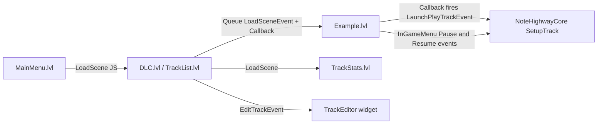

# Game Architecture

> Verified against game commit 1714270, 2026-07-10. Engine submodule at 047f57b8.

How Drumsmith hangs off MitchEngine: the entry point, what gets registered, how scenes and events wire the game flow together, the global singletons, and the settings file. For the engine side of everything here (frame loop, ECS, events), see `Engine/Docs/Architecture.md`, `Engine/Docs/ECS.md`, and `Engine/Docs/Jobs-and-Events.md`.

## Overview

Drumsmith is almost entirely data plus cores/components driven by the engine loop. The `GameApp` subclass is deliberately empty except for loading the first scene; all real behavior lives in:

- **Scene-loaded cores** (`NoteHighwayCore`, `VocalsTestCore`) declared in `.lvl` files, ticked only while the world runs.
- **UI controller components** (`BasicUIView` subclasses) that bridge Ultralight HTML pages to game logic.
- **Global singletons** for settings, track data, MIDI, and menu music.

Navigation between menus and gameplay is done by loading whole scenes; the handoff of "which track to play" rides on a queued `LoadSceneEvent` callback.

## Key Files

| Path | Role |
|------|------|
| `Game_EntryPoint/Source/main.cpp` | `ME_APPLICATION_MAIN(GameApp)` — defines `main()`, includes `ComponentRegistry.h` |
| `Game/Source/GameApp.cpp` | `Game` subclass; `OnInitialize` loads `Assets/MainMenu.lvl`, everything else is empty |
| `Game/Source/ComponentRegistry.h` | Umbrella header whose includes pull in every `ME_REGISTER_*` macro |
| `Game/Source/Events/GameEvents.h` | The four game events (see below) |
| `Game/Source/Config/GameSettings.h` | Settings singleton persisted to `Settings.json` at the working directory |
| `Game.sharpmake.cs` | Game project + solution definition; rtmidi/midifile linkage, FMOD/dotnet paths |
| `Assets/Config/Engine.cfg` | Engine window/scene config (see `Engine/Docs/Platform-Window-Input-Config.md`) |

## How It Works

### Entry point and registration

`Game_EntryPoint/Source/main.cpp` is eight lines: it includes `ComponentRegistry.h` (which transitively includes every game component/core header so their registration macros run) and expands `ME_APPLICATION_MAIN(GameApp)`. `GameApp::OnInitialize` calls `Engine::LoadScene("Assets/MainMenu.lvl")`; `OnStart`/`OnUpdate`/`OnEnd`/`PreRender`/`PostRender` are all empty.

Registered game types:

| Type | Macro | Registered as |
|------|-------|---------------|
| `MainMenuController`, `DLCMenuController`, `TrackListMenuController`, `TrackStatsMenuController`, `InGameMenuController`, `VocalsTestComponent` | `ME_REGISTER_COMPONENT` | UI controller components (`BasicUIView` subclasses) |
| `NoteTrigger` | `ME_REGISTER_COMPONENT_FOLDER(NoteTrigger, "Game")` | Per-note timing data component |
| `NoteHighwayCore`, `VocalsTestCore` | `ME_REGISTER_CORE` | Scene-loaded gameplay cores |
| `TrackEditor`, `PadBindingWidget` | `ME_REGISTER_EDITOR_WIDGET` | Havana editor widgets (`ME_EDITOR` builds only) |

### Scenes and game flow

Scenes in `Assets/`: `MainMenu.lvl`, `DLC.lvl`, `TrackList.lvl`, `Example.lvl` (the gameplay scene — note highway lanes + `NoteHighwayCore`), `TrackStats.lvl`, `Vocals.lvl`. UI pages navigate by calling the engine-provided `LoadScene` JS binding (`BasicUIView::LoadScene` in `Engine/Source/Components/UI/BasicUIView.cpp` queues a `LoadSceneEvent`); the engine also injects `PlaySound` and `Quit` into every page.

Starting a song is a two-step handoff in `DLCMenuController::SelectTrackToPlay` (and the same pattern in `TrackListMenuController`):

1. Configure a `LoadSceneEvent` for `Assets/Example.lvl`, including its `Callback`, then call `Queue()`. Queuing copies the fully configured event for next-frame delivery.
2. When the scene has loaded, the callback fires `LaunchPlayTrackEvent` (synchronously, main thread), which the freshly created `NoteHighwayCore` — registered as a receiver in `OnAddedToWorld` — handles by calling `SetupTrack`.

### Game events

All four game events (`Game/Source/Events/GameEvents.h`) dispatch synchronously on the main thread through typed handlers — see `Engine/Docs/Jobs-and-Events.md` for the rulebook. `TrackEditor` uses `Listen<T>` with automatic deregistration on destruction. `NoteHighwayCore` owns scoped `EventSubscription` objects while it belongs to a world and resets them in `OnRemovedFromWorld`.

| Event | Payload | Fired by | Received by |
|-------|---------|----------|-------------|
| `LaunchPlayTrackEvent` | `TrackID`, `TrackIndex`, `Callback` | `DLCMenuController::SelectTrackToPlay`, `TrackListMenuController` (via `LoadSceneEvent` callback) | `NoteHighwayCore` launch subscription → `SetupTrack` |
| `InGamePauseCurrentTrack` | — | `InGameMenuController::Internal_Pause` (JS) | `NoteHighwayCore` → `AudioPack::Pause` |
| `InGameResumeCurrentTrack` | — | `InGameMenuController::Internal_Resume` (JS) | `NoteHighwayCore` → `AudioPack::Resume` |
| `EditTrackEvent` | `FileName` | `DLCMenuController::EditTrack`, `TrackListMenuController::EditTrack` (JS) | `TrackEditor` typed listener (`ME_EDITOR` only) |

Only the `TrackIndex` field of `LaunchPlayTrackEvent` is consumed (the launch subscription indexes `TrackDatabase::m_trackList.m_tracks` with it); `TrackID` and `Callback` are set by senders but unused by the receiver.

### Global singletons

All are `ME_SINGLETON_DEFINITION`, lazily constructed on first `GetInstance()`, main-thread only:

| Singleton | Location | Owns |
|-----------|----------|------|
| `GameSettings` | `Game/Source/Config/GameSettings.h` | User settings, `Settings.json` persistence |
| `TrackDatabase` | `Game/Source/CoreGame/TrackList.h` | The scanned track list, sort/filter state — see `Docs/Songs-and-DLC.md` |
| `CustomTrackDefineTest` | `Game/Source/CoreGame/CustomTrackDefineTest.h` | `song.ini` / `.chart` / `notes.mid` parsing — see `Docs/Songs-and-DLC.md` |
| `PadMappingStorage` | `Game/Source/Editor/PadBindings.h` | Keyboard/MIDI pad bindings — see `Docs/MIDI-and-Pads.md` |
| `MidiDevice` | `Game/Source/Midi/MidiDevice.h` | The RtMidi input port — see `Docs/MIDI-and-Pads.md` |
| `TrackRadio` | `Game/Source/Global/TrackRadio.h` | Menu background music — see `Docs/Audio.md` |

### Settings

`GameSettings` loads `Settings.json` from the working directory in its constructor (creating it via `Save()` if missing). Fields, and who actually reads/writes them:

| Field | JSON key | Written by | Read by |
|-------|----------|------------|---------|
| `RadioVolume` | `RadioVolume` | `MainMenuController::SetRadioVolume` (JS slider) | `TrackRadio` (applied to the radio `AudioPack` when a track starts playing) |
| `DLCURL` | `DLCURL` | `MainMenuController::SetDLCURL` (only if downloading `dlc_index.json` from the new URL succeeds) | `DLCMenuController::DownloadDLC` |
| `PreferredMidiDevice` | `Device` | `MainMenuController::SetPreferredMidiDevice_Internal` | `NoteHighwayCore::OnAddedToWorld` → `MidiDevice::OpenMidiDevice` |
| `AudioLatency` | `AudioLatency` | `MainMenuController::SetAudioLatency_Internal` | **nothing** — persisted but never consumed |
| `VideoLatency` | `VideoLatency` | `MainMenuController::SetVideoLatency_Internal` | **nothing** — persisted but never consumed |

Persistence is explicit: nothing auto-saves; the JS `SaveSettings` binding calls `GameSettings::Save()`. Hit-detection timing uses a hardcoded offset instead of these fields — see `Docs/Latency-and-Responsiveness.md`.

### Build wiring (game side)

`SharpGameProject` in `Game.sharpmake.cs` extends the engine's `BaseGameProject` and adds the game-only third-party deps:

- Include paths: `ThirdParty/rtmidi`, `ThirdParty/midifile/include`, `ThirdParty/USB-MIDI/include`.
- **All four platforms link `rtmidi` and `midifile`** (Win64/UWP add `winmm.lib`; Win64 adds `winhttp.lib`; macOS adds `curl`; Linux adds `libasound.so` + `libcurl.so`). The Win64-only MIDI *gameplay* gate is a source-level `#if`, not a build limitation — see `Docs/MIDI-and-Pads.md`.
- `SharpGameSolution` sets machine-specific `Globals.FMOD_*_Dir` / `Globals.DOTNET_Win64_Dir` paths and enables `IsPhysicsEnabled3D` + `IsUltralightEnabled`.

The Vue UI in `Game/ui/` builds separately (`npm run build`) into `Assets/UI` — see `Docs/UI-and-Menus.md`. The full project graph lives in `Docs/SharpmakeDependencies.md`; engine-side flags and generators in `Engine/Docs/Build-System.md`.

## Caveats & Fragility

- **The `LaunchPlayTrackEvent` handoff depends on receiver timing.** `NoteHighwayCore` only receives the event because scene-core creation (`OnAddedToWorld` registration) happens during `LoadSceneEvent` processing, before the load callback runs. If the callback ever fires before the new scene's cores register, the event is silently lost — `EventManager` has no delivery guarantee for unregistered receivers.
- **Queued scene loads snapshot their callback.** Finish configuring the scene path and callback before calling `Queue()`; later changes to the local event are not delivered.
- **`GameSettings` writes are not transactional.** Settings mutate immediately on each JS setter, but persist only when the UI calls `SaveSettings`. A crash loses changes; there is no cancel/revert path.
- **`AudioLatency`/`VideoLatency` are write-only.** The UI, the singleton, and the JSON file all carry them; no gameplay code reads them.
- **`GameApp` has no shutdown logic**, and the engine itself does no core teardown on exit (see `Engine/Docs/Architecture.md`) — singletons and open MIDI ports are reclaimed by process exit, not by code.
- **`Assets/Config/Engine.cfg` carries two titles**: a root-level `"Title": "Drumsmith"` and `Window.Title: "MitchEngine"`. `EngineConfig::OnLoadConfig` (`Engine/Source/Config/EngineConfig.cpp`) reads only the `Window.Title` sub-key, so the window is titled "MitchEngine" and the root key is dead data.

## Related Docs

- `Docs/Gameplay-Note-Highway.md` — what `NoteHighwayCore` does with `LaunchPlayTrackEvent`
- `Docs/Songs-and-DLC.md` — `TrackDatabase` and content formats
- `Docs/MIDI-and-Pads.md`, `Docs/Audio.md`, `Docs/UI-and-Menus.md` — the subsystems referenced above
- `Docs/Latency-and-Responsiveness.md` — why the unused latency settings matter
- `Engine/Docs/Architecture.md` — the frame loop that drives all of this
