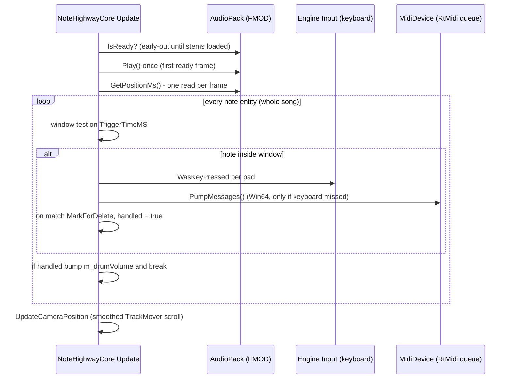

# Gameplay: The Note Highway

> Verified against game commit 1714270, 2026-07-10. Engine submodule at 047f57b8.

`NoteHighwayCore` end to end — how a selected track becomes note entities, how the highway scrolls, exactly how hits are judged, and what happens (and doesn't) on hit and miss. Appendix: the experimental vocals mode.

## Overview

`NoteHighwayCore` is a scene-loaded core (declared in `Assets/Example.lvl`) filtering on `Transform + NoteTrigger`. It owns the whole play session: it receives `LaunchPlayTrackEvent`, spawns one entity per chart note, starts the stems via `AudioPack`, and every frame compares the song position against each note's trigger time to judge input. There is **no scoring, combo, or miss handling** — a judged hit deletes the note entity; everything else just scrolls past.

## Key Files

| Path | Role |
|------|------|
| `Game/Source/Cores/NoteHighwayCore.h` | The core: lanes map, prefab map, `AudioPack`, track pointer |
| `Game/Source/Components/NoteTrigger.h` | Per-note data: `TriggerTime`, `TriggerTimeMS`, `NoteName`, `EditorLane` |
| `Assets/Prefabs/Notes/NewBaseNote.prefab` | Default note visual (Transform + textured Mesh) |
| `Assets/Prefabs/Notes/BassNotePrefab.prefab` | Bass-lane note visual |
| `Assets/Example.lvl` | Gameplay scene: lane entities, `TrackMover`, the core declaration |
| `Game/Source/Cores/VocalsTestCore.h` | Experimental vocals pitch detection |

## How It Works

### Lifecycle

- `OnAddedToWorld`: registers for `LaunchPlayTrackEvent` / `InGamePauseCurrentTrack` / `InGameResumeCurrentTrack`, and opens the MIDI device from `GameSettings::PreferredMidiDevice` (see `Docs/MIDI-and-Pads.md` for the fallback behavior).
- `OnStart`: resolves the lane entities by **hardcoded child names** on the scene root — `"open_hh"`, `"closed_hh"`, `"Snare1"`, `"Crash1"`, `"crash2"`, `"Bass1"`, `"ride1"`, `"tom1"`, `"tom2"`, `"tom3"` — storing each under its lowercase lane-name key in `m_lanes`, plus `"TrackMover"` (the entity that scrolls). Note the inconsistent casing between scene names and map keys; the lookup dereferences `GetChildByName` results unchecked.
- The typed launch subscription calls `SetupTrack(TrackDatabase tracks[TrackIndex])` and returns `true` (stops event propagation). Typed pause/resume subscriptions forward to the `AudioPack` without consuming the event.
- `OnStop` stops the pack. `OnRemovedFromWorld` resets the three scoped event subscriptions; they also deregister automatically if the core is destroyed. The MIDI device stays open.

### Track setup

`SetupTrack`:

1. `ShutdownTrack()` — marks all existing note entities for delete, stops audio.
2. `TrackData::LoadNoteData()` — parses `NoteData.txt` (see `Docs/Songs-and-DLC.md`).
3. Per `NoteData`: `World::CreateFromPrefab` — `m_notePrefabs` maps `PadId::Bass` to `BassNotePrefab.prefab`, everything else uses `NewBaseNote.prefab`; sets the mesh `DiffuseColor` from `PadUtils::GetNoteColor`; positions the note at `Z = m_triggerTime * m_noteSpeed` (seconds × units/second); parents it to its lane via `m_lanes[m_noteName]`; fills a `NoteTrigger` component with the timing fields.
4. Constructs the `AudioPack` (stems begin async loading — see `Docs/Audio.md`).

All notes for the entire song exist as live entities from the first frame.

### The per-frame update

Key mechanics, in source order (`NoteHighwayCore::Update`):

- **The judge clock** is `m_currentTrackPack.GetPositionMs()` — the main stem's FMOD channel position — read **once per frame** into `noteTime`.
- **The window math**, per note:
  - `baseHitWindowMs = 50.0f`
  - `actualHitWindow = std::max(baseHitWindowMs / m_noteSpeed, baseHitWindowMs)` — dividing then clamping back up means `noteSpeed > 1` (every real chart; converted tracks use 10–30) leaves the window at exactly ±50 ms, and `noteSpeed < 1` *widens* it.
  - `difference = noteTime + globalOffsetMs - triggerTime` with `int globalOffsetMs = -30` **hardcoded** (the `GameSettings::AudioLatency`/`VideoLatency` values are never consulted).
  - The note is hittable while `|difference| < actualHitWindow`.
- **Keyboard path**: for each in-window note, every mapped pad is tested with `Input::WasKeyPressed`; a match on the note's `EditorLane` marks the note for delete. A debug `BRUH_FMT` logs the hit offset for **any** bound key press while any note is in window.
- **MIDI path** (`#if USING(ME_PLATFORM_WIN64)` only): if the keyboard didn't hit, `MidiDevice::PumpMessages()` is called **inside the per-note loop** — the queue is drained while examining one note, and note-ons that don't match *that* note's lane are discarded. See Caveats.
- **One hit per frame**: `handled` is set on any hit and `break`s out of the note loop; the drum-volume bump (`m_drumVolume + .5f`, clamped) happens then — but the `AudioPack::SetDrumVolume` call that would make it audible is commented out, so it has no effect.
- **Scrolling**: `UpdateCameraPosition` moves the `TrackMover` entity toward `Z = songTimeSec * noteSpeed` with exponential smoothing (`smoothFactor = 10`) — the visual highway is a smoothed, lagging function of the judge clock, not a direct read.

### What's missing (stated as fact)

- **No miss detection**: notes whose window passes stay alive (parented behind the scrub position) until `ShutdownTrack`.
- **No scoring/accuracy/combo state** of any kind; `difference` is computed and thrown away (except the debug log).
- **No hit feedback**: no hit sound (`Drumset` is not instantiated in gameplay — `Docs/Audio.md`), no particle/animation; the only visual is the note vanishing, and that is deferred — `MarkForDelete` queues into `EntityCache.Killed`, processed by `World::Simulate` at the start of the **next** frame, so a hit note renders for one more frame.

### Appendix: the vocals experiment

`VocalsTestCore` (+ `VocalsTestComponent`, `Assets/Vocals.lvl`) is an experimental pitch-detection mode: it attaches an FMOD FFT DSP, finds the dominant frequency bin each update, converts it to a MIDI note number (`12 * log2(f/440) + 69`), and smooths the result — currently printed to stdout rather than driving gameplay. Treat it as a spike, not a feature.

## Caveats & Fragility

- **The MIDI pump location is the core gameplay bug.** Draining the RtMidi queue per-note means: (a) simultaneous hits (kick+snare) can't both register — messages consumed while checking the first in-window note are gone when the second note is checked, and `break` ends the frame after one hit anyway; (b) with **no** note in window, nothing pumps, so hits pile up in the queue and are consumed seconds later as if fresh — a stale kick can "hit" the next kick note the moment it enters its window; (c) polling is bounded by frame rate — up to a full frame of input latency (see `Docs/Latency-and-Responsiveness.md`).
- **The author knows**: the loop is annotated "`I need to keep track of where we are in a track to avoid itr on entities / this whole shit is fucked`" and the input block "`drunk me fucked this up`" — treat this function as scheduled for rewrite, not a pattern to extend.
- **O(all notes) every frame**: the update iterates every note entity in the song (4,872 for the bundled Everlong chart) doing two component lookups each, with no start index or windowing — contrast `TrackEditor`'s cached `m_closestNoteIndex`.
- **The hit-window scaling is inverted-then-neutralized** (`max(50/noteSpeed, 50)`); as written, `noteSpeed` can only ever *widen* the window (for values < 1), which is almost certainly not the intent.
- **`m_lanes` lookups can silently create null entries**: `m_lanes[it.m_noteName]` uses `operator[]` — an unknown lane name inserts a null handle and only an `ME_ASSERT` (debug-only) complains; in release the note spawns unparented at world origin.
- **`OnStart` dereferences `GetChildByName(...)` unchecked** — a gameplay scene missing any hardcoded lane name (or with different casing) crashes on scene start.
- **The one-shot autoplay flag**: `m_hasStartedTrackYet` is never reset by `SetupTrack`/`ShutdownTrack` — it happens to work because the core starts fresh with each scene load, but replaying a second track within one scene would skip the `Play()` (or double-start).
- **`PlayStem` is declared in the header but has no definition** — dead declaration, will only fail if someone calls it.
- **`NoteTrigger::TriggerTimeMS` is a `float`** holding a millisecond count (source data is `uint32_t`); fine below ~16.7M ms, but it's a type mismatch waiting for an equality comparison.
- **Pause/resume handlers do not consume their events** (fine today — no other receivers), while the launch handler returns `true`; be aware of the propagation-stopping semantics (`Engine/Docs/Jobs-and-Events.md`).

## Related Docs

- `Docs/Latency-and-Responsiveness.md` — the full timing budget through this code
- `Docs/MIDI-and-Pads.md` — `PumpMessages`, bindings, the Win64 gate
- `Docs/Audio.md` — `AudioPack` readiness, position query, stem sync
- `Docs/Songs-and-DLC.md` — where `NoteData` comes from
- `Engine/Docs/ECS.md` — cores, filters, `World::Simulate` deletion timing
