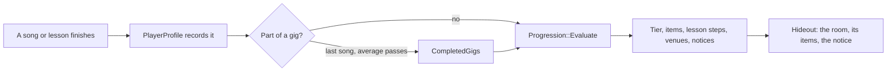

# Hideout and Progression

> Verified against the working tree on 2026-11-18 (game commit 7ee80ad plus the uncommitted rooms work). Engine submodule at f401189d. Headless (lavapipe) captures, editor UI automation and unit tests only: nothing here has been played with sticks or heard on speakers yet.

The main menu is a room, the hideout. It starts as a basement and moves up to a garage, a rehearsal space and a studio as the player plays gigs. A label floats over each thing in the room: the kit plays a song, the practice pad opens the lessons, and so on. What the player has done is kept in a profile. Data-driven rules turn that record into a room, items, lessons and venues. Library songs are never locked.

## Overview

Four pieces, each usable without the next:

1. **The record** (`PlayerProfile`, `Docs/Game-Architecture.md` → Player profile): each song's bests and each lesson's results, saved in `Profile.json` when a run finishes.
2. **The rules** (`Progression`, `Assets/Progression/Progression.json`): rooms (tiers), gigs, the lesson ladder, milestones, items and venue gates. `Progression::Evaluate` turns the record into unlocks and queues a notice for each new one.
3. **Gigs** (`GigSession`): a short setlist from the player's own library, played back to back at the gig's venue. Its average accuracy decides whether it is completed, and completing one moves the hideout up.
   **Story mode** (`Assets/Progression/Story.json`, below) rides on the same rules and sessions: thirteen authored five-song sets, each song banked as it is played, with auditions that fill the band's seats between them.
4. **The room** (`Hideout`, `Assets/Hideout/*.lvl`): the tier's scene, loaded behind the main menu. It shows unlocked items, labels the stations, flies the camera to the one picked, and plays the menu music as the radio in the room would.

## Key Files

| Path | Role |
|------|------|
| `Game/Source/Config/PlayerProfile.h/.cpp` | The record and `Profile.json` |
| `Game/Source/CoreGame/Progression.h/.cpp` | The rules: loading, `Holds`, `Evaluate`, lesson and venue gates, `Setlist` |
| `Assets/Progression/Progression.json` | The journey itself: tiers, gigs, lesson steps, milestones, items, venue gates |
| `Game/Source/CoreGame/GigSession.h/.cpp` | The gig (or story set) being played |
| `Assets/Progression/Story.json` | Story mode: the sets, the auditions and the rewards' items. Generated: don't edit it |
| `Tools/Story/make_story.py` | Writes `Story.json` from `Design/Story-Mode-Setlists.json`, the writers' manifest (staging, cues, alternates, casting) |
| `Tools/Story/make_stub_songs.py` | Writes a stand-in song in `Assets/DLC/Story/<Artist - Title>/` for every story song the library hasn't got |
| `Design/Story-Mode-Setlists.md` | The story as written: every set's songs, staging and rewards |
| `Game/Source/Hideout/Hideout.h/.cpp` | The room behind the main menu |
| `Game/Source/Hideout/HideoutDebug.cpp` | The debug menu (F2) |
| `Game/Source/Components/Hideout/HideoutMarkers.h/.cpp` | `HideoutStation`, `HideoutItemSlot`, `HideoutView`, `HideoutMotion`, `HideoutDrummer`, `HideoutBandName`, `HideoutWhen`, `HideoutReadout` |
| `Assets/Hideout/Basement.lvl`, `Garage.lvl`, `Rehearsal.lvl`, `Studio.lvl` | The rooms (generated) |
| `Tools/Hideout/make_hideout.py` | Writes the rooms with `Tools/Venues/venuegen.py`: `basement.py`, `garage.py`, `rehearsal.py` and `studio.py` in `Tools/Hideout`, with helpers from `hideoutgen.py` |
| `Tools/Hideout/make_textures.py` | Draws `Assets/Hideout/Textures/*.png` with ImageMagick: concrete, wood, cardboard, egg cartons, foam, blankets, rugs, the banners, the posters, the flyers, the screens, the whiteboard, the windows by day and night |
| `Tools/Hideout/make_sounds.py` | Synthesises the room tone in `Assets/Hideout/Sounds/*.wav` with ffmpeg |
| `Assets/Fonts/PermanentMarker-Regular.ttf`, `GochiHand-Regular.ttf` | The handwriting: marker and pen, in the textures, the world text and the labels (Apache 2.0 and OFL; their licences beside them) |
| `Assets/MainMenu.lvl` | The menu camera, with the room's `PostProcess` |
| `Game/Tests/Source/PlayerProfileTests.cpp`, `ProgressionTests.cpp` | The record, the rules, the shipped journey and story, setlists, gigs, story banking and auditions, venue gating |

## How It Works

### The rules

`Progression.json` has six lists. A `Requires` object can sit on anything and holds when every field it sets holds:

| Field | Holds when |
|-------|-----------|
| `Tier` | the hideout is at that tier or above |
| `Gigs` | those gigs are completed |
| `LessonSteps` | every lesson of those ladder steps has passed |
| `LessonsPassed`, `SongsPlayed`, `FullCombos` | the profile counts at least that many (different songs) |
| `SongsAtAccuracy` + `Accuracy` | that many songs have a best accuracy of at least that |
| `StorySets` | those story sets passed |
| `Members` | those band seats filled (`bass`, `guitar`, `vocals`, `keys`) |

- **Tiers** are the rooms in order, each with its `Scene` and `Rewards` (item ids). The first needs nothing. The hideout moves to the highest tier whose requirement holds, and never moves back down.
- **Gigs**: `Venue` (a registry id such as `Backyard`, or a room name `Club` / `Festival` / `Arena`), `Songs`, a notes-per-second range (`MinNotesPerSecond`, `MaxNotesPerSecond`; `m_noteCount / m_duration`, a stand-in for difficulty since charts carry no rating), optional `SongKeys` (song folders to use first), `PassAccuracy` and `Rewards`.
- **LessonSteps**: the ladder. A step's `Lessons` (practice lesson ids) open together when its requirement holds. A step with no requirement is open from the start. Passing every lesson in a step gives its `Rewards`. The shipped ladder covers all 16 lessons, and a test checks that.
- **Milestones**: a requirement and `Rewards`.
- **Items**: `Id`, `Name`, `Description`, and `Slot`, the `HideoutItemSlot` that shows it.
- **Venues**: free play's gates. A venue with no gate is always open.

`Evaluate` loops until nothing changes, so one unlock can lead to another (a gig moves the tier up, which opens the next gig). Each unlock goes into `PlayerProfile::UnlockedItems` as `kind:id` (`tier:garage`, `item:practice-pad`, `step:grooves-1`, `lessons:rudiments-1`, `milestone:first-song`, `gig:club-night`, `venue:Club`), so it is announced once. Its text is also queued on `PlayerProfile::Notices`. It runs after every recorded result (`NoteHighwayCore::RecordResult`, which shows the new unlocks on the results screen) and when the hideout loads, which also gives a new player the first room's rewards.

`--unlock-all` (`Progression::UnlockAll`) opens every lesson, gig, venue and item, without touching the profile. A missing or broken `Progression.json` also opens everything, with a log line.

### Story mode

`Progression` also loads `Story.json` (`LoadStory`; a root passed to `Load` with `Sets` or `Auditions` loads them too, for tests). The design is `Design/Story-Mode-Setlists.md`; `Tools/Story/make_story.py` turns its manifest into the game file, keeping only what the game reads.

- **Sets** (`ProgressionStorySet`): `Act`, `Name`, `Description`, `Venue` (a gig venue, or empty to keep the player's own: the basement and the radio studio have no stage room yet), `VenueBase`, `PassAccuracy`, `Requires`, five `Songs`, `Rewards`, `MovesInto` (a tier id), `Audition`, and the flags `Credits` (passing it ends the story), `PostCredits` (shown only once the credits have rolled) and `OneSitting`.
- **Songs** are recordings, not charts: `Artist`, `Title`, `Spotify` and `Flags` (the venue's state once the song is done). `StorySetlist` finds each in the library by the chart's `Links.Spotify` track id, else by the first artist and the title with "- Remastered…" and "(feat. …)" cut. A song with no chart is -1, and the set can't start until every song is found. **When charting a story song, put its Spotify link in the chart's Links** so a retitled chart still matches.
- **Stand-ins.** `make_stub_songs.py` gives every story song the library lacks a folder in `Assets/DLC/Story/` (the library reads that folder's song folders too, `TrackDatabase::kStoryFolder`): a 120 BPM click as `song.ogg` for the recording's length, a plain rock beat as `NoteData.txt`, and a `TrackData.txt` with the recording's Spotify link, `DLCSource` `story-stub` and `Genre` "Story: <set>". So every set plays now. The manifest's `ProposedSets` (sets not yet placed in the campaign, such as `Design/Highway-to-the-Afterlife.md`) and any song's `Backup` get stand-ins too. A song already in `Assets/DLC` by artist and title gets none (five of the 65), and an existing folder is never rewritten without `--force`. To chart the real song, put its audio and chart in that folder, or put the real song anywhere in `Assets/DLC`: `StorySetlist` takes a real chart (by link, else by artist and title) over a stand-in (`DLCSource` `story-stub`) even when only the stand-in carries the link. The stand-ins are ordinary songs, so free play and the side gigs list them too. Deleting one from the song list doesn't work (`RemoveTrack` only deletes folders directly under `Assets/DLC`).
- **Banking.** `GigSession::BeginStory` starts a set at `StoryNextSong` (the first song not banked; the top once all are), with the banked songs already counted. `NoteHighwayCore::RecordResult` banks each story song into `PlayerProfile::Story[set].Banked` (`GigSession::Bank`, best only) and saves, so leaving mid-set keeps it. The set passes when every song is banked and the average reaches the mark; `Complete` sets `Passed`. A `OneSitting` set banks nothing, so leaving starts it over.
- **The venue's state.** Each set has its own venue scene, `Assets/Venues/Story*` (`make_story.py`'s `VENUES`; a set whose folder is missing falls back to its `VenueBase` room). `GigSession::LaunchCurrent` stages the song (`StageStory` into `VenueRegistry::Story()`): the flags of every song before it from the start, its own `Flags` at its `Cue`. The venue's `VenueStory` props follow them (`Docs/Venue-Authoring.md` → VenueStory). `StoryFlags` is the same from the profile's banked songs.
- **Debugging a set.** The F2 panel's *Story sets passed* toggles a set (on: every song banked at 100%; *Apply the rules* gives its rewards). In non-Retail builds each story set on the gig board has DEBUG: PLAY SONG 1-5, which plays that song of the set whatever is locked or banked. `--gig <set> --story-song N` does the same from the command line; `--unlock-all` books every set.
- **Evaluate**: a passed set unlocks `story:<id>` ("Finished: …", or "The story is told: …" for the credits set), gives its rewards and moves the hideout up to `MovesInto` if it's higher. That is on top of the tiers' own rules, so the old gigs still move the room too. A set whose requirement now holds is announced as `booking:<id>`.
- **Auditions** (`ProgressionAudition`): a `Seat`, the set it comes `After`, `Optional`, and two or three `Candidates` (name, description, leanings, pitch, and a `Body` and `Clothes` from `People.generated.h`). `PendingAudition` is the first whose set has passed and whose seat is empty and not declined. `ChooseMember` writes `PlayerProfile::BandMembers[seat]`; `DeclineAudition` leaves an optional seat empty (`declined:<id>` in `UnlockedItems`). Nothing reads the members' looks yet: the band on stage is still cast from the song.
- **The gig board** lists a pending audition first (a TAKE button per candidate, KEEP THE SEAT EMPTY for an optional seat), then the story sets (the bonus only after the credits), then the side gigs. A story set shows its songs, each banked score or "(no chart yet)", NEEDS N CHARTS while any is missing, and PLAY SONG N to resume. The hideout's goal names a pending audition, else the first open story set the library can play, else the gigs as before.
- `--gig <story set id>` starts a story set at its next song, for headless checks.
- **Proposed sets.** `make_story.py` writes the manifest's `ProposedSets` to `Story.json`'s own `ProposedSets` (`Progression::ProposedStorySets`). Nothing books, unlocks or lists them in the campaign; `FindStorySet` finds them, so `--gig <id>` plays one, and in non-Retail builds (`Hideout::DebugAllowed`) the gig board lists each as "PROPOSED: …", always booked, with the usual DEBUG: PLAY SONG buttons.
- **A song's own staging.** Besides `Flags` at its `Cue`, a song can carry `Moments` (each a `Cue` and the `Flags` landing there, and optionally a `Caption` line shown on screen; the manifest's `Moments`, `On`, `StateAfter` and `Caption`), its own `Venue` (forced while it plays, `GigSession::ApplyVenue`; otherwise the set's) and `HighwayRests` (the highway melts away through long rests: `NoteHighwayCore::UpdateHighwayRests`). `StageStory` stages a song's moments with its cue, and counts every earlier song's moments as already happened, except `band_` flags (the live band's state: `Docs/Venue-Authoring.md` → VenueStory), which are each song's own. The cue names are `VenueShow::StoryCueTime`'s (`Docs/Venue-Authoring.md` → VenueStory).
- **Continuous sets.** A set with `Continuous` is one show (`Docs/Gameplay-Note-Highway.md` → A continuous show): each song is recorded and banked at its last note, its tail plays while the next song's stems open, and the next song takes over in the same scene (`GigSession::Advance`), at its own venue, with no countdown or results screen until the last song. A Continuous set is usually `OneSitting` too: leaving starts it over. Retry restarts the current song as an ordinary play (with a countdown, the show's running score reset).

### Lessons

`Progression::LessonOpen`: a lesson in no step is open; one in a step opens with the step. A lesson already passed stays open, and so does one marked `lesson:<id>` in the profile (kept for unlocking a lesson from a song, which isn't built). The practice page tags each row PASSED or LOCKED. The details say what passing takes, or which step opens the lesson. START is hidden for a locked lesson, and `PracticeMenuController::StartLesson` refuses one. `--practice` from the command line is not gated.

### Venues in free play

`ChooseVenue` (`Docs/Venue-Authoring.md` → How a venue is chosen) gets two inputs. `GigVenue`, the gig's venue, comes after `--venue` / `--venue-style` and before everything else. `VenueOpen` gates the player's picks: the player's `VenueId` is skipped when locked, and a locked `VenueStyle` room (or a Random pick of one) falls back to an open room, or else the first open, non-hidden scene. `ChooseForSong` fills both from `VenueRegistry::GigVenue()` and `Progression::VenueOpen`. A song's own venue and the command line are not gated, and neither is anything in a run started with `--play-track` (headless captures keep the setting's venue). With the shipped gates a new player gets the Backyard until Club Night is played.

### Gigs

The gig board lists every gig: its description, venue, length and pass mark. An open one also shows its setlist and PLAY THE GIG. `Progression::Setlist` takes the gig's `SongKeys` first, then songs ordered by how far their notes-per-second falls outside the range (0 inside it, rounded to half a note a second). Within the same distance the order comes from an FNV hash of the gig id and the song folder, so the same library always gives the same set. One copy of each title is used (a library can hold a song twice). Songs with no notes are left out.

`GigSession::Begin` sets the venue (`VenueRegistry::GigVenue()`) and `LaunchCurrent` loads the gameplay scene with the first song (`TrackRadioUtils::LaunchTrack`). Each recorded song keeps its best accuracy this gig, so a Retry can only raise it. When every song has been recorded, the set's average against `PassAccuracy` decides. A pass adds the gig to `CompletedGigs`, then `Evaluate` runs. The results screen shows the gig and song number (`gig`, `gig_name`, `gig_progress`), NEXT SONG while songs remain (`gig_next`), the set's verdict on the last one (`gig_result`), and BACK TO THE HIDEOUT. Escape on the results moves on the same way. Exit from the pause menu, or BACK TO THE HIDEOUT, abandons the gig (`InGameMenuController::LeaveGig`). Loading the hideout ends any gig still open.

`--gig <id> [--gig-songs N]` starts a gig as the hideout loads, for headless checks. With `--highway-autoplay --record-autoplay` the songs count.

### The room

`MainMenuController` owns a `Hideout` and starts it on its first update, under the menu's own camera entity. `Hideout::Start` reads the tier's scene (`--hideout-room <path>` overrides it) and instances it as a prefab is: fresh GUIDs, no cores. It then walks the entities:

- `HideoutView`: where the overview camera stands. It looks along local +Z with its `FieldOfView`.
- `HideoutStation`: `Station` (Kit, PracticePad, Radio, Laptop, TrophyWall, Mixer, GigBoard, Door, Wishlist), an optional `Label`, and `ViewOffset` / `FieldOfView` for the camera once it is picked. The entity's position is what the camera looks at.
- `HideoutItemSlot`: `Slot`. If an item names the slot and isn't unlocked, the entity and its children are deleted. A slot no item names stays. With `WhenLocked` it's the other way round: a stand-in (tape round where the pad will go, a note saying the gold record goes here) shown only until the item comes.
- `HideoutWhen`: `Day` or `Night` by the player's clock (day is 7:00 to 19:00), `MovingIn` only on the first visit after moving into the room, `Settled` on every visit after. The rest is deleted at load, as a locked slot is.

Each frame `Hideout::Update` eases the camera toward the overview or the chosen station, with a slow sway in the overview. Picked, the camera aims a little left of the station so it sits in the part of the screen the panel leaves open. Each station's position is projected through the camera (`GetProjectionMatrix() * WorldToCamera`, one frame behind) into the `stations` list as percentages, kept clear of the screen edges, for the labels in `MainMenu.rml`. Picking a station flies the camera there. Once it has nearly arrived (at least 0.35 s, at most 1.2 s), the station acts: Kit loads the library, PracticePad the lessons, Laptop the DLC page, Mixer opens the settings panel (closing it returns to the overview), Radio shows the radio widget, TrophyWall, GigBoard and Wishlist open their panels (`hideout_panel`), and Door quits. The trophy wall's records are the counts, the player's five best songs by accuracy (full combos marked), and the milestones. The wishlist lists every item, what's still to come first (what can be worked on now, then what needs something else first, then a later room's), each with how to get it (`Progression::HowToUnlock`: "Pass Rudiments I on the practice pad (1 of 2 lessons)", "Move into the Garage: play Backyard Party"), then what's already in. Each row's SHOW ME (`wish_show`, `Hideout::ShowItem`) flies the camera to where the item is, or will be (its tape outline or note, when the room has one), for four seconds with "SOON: <name>" and how to get it on the note (`hideout_reveal`, `hideout_reveal_how`). Every slot's place is measured as the room loads (`m_slots`), the locked ones' too, before their pieces go. `--hideout-show <item id>` does it once at start, for captures. Escape leaves a station or dismisses the notice. The header shows the room, its description and the next goal (`Hideout::NextGoal`). Notices queued since the last visit show once as *While you were out* (*Welcome to the Garage* on moving in), then are cleared from the profile.

The page binds `hideout`, `hideout_focus`, `hideout_room`, `hideout_room_text`, `hideout_goal`, `hideout_panel`, `hideout_notice`, `hideout_title`, `hideout_hint`, `hideout_status` and the lists `stations`, `records` and `gigs`. `Hideout::RegisterModel` sets them all before the first update. Events: `station(i)`, `hideout_back`, `dismiss_notice`, `gig_play(i)`. With no room (no tier scene, or one that can't be read) `hideout` stays 0 and the old flat menu shows.

`--hideout-station N` starts at station N, its action included; `--hideout-look N` only frames it. `--hideout-eye x,y,z --hideout-target x,y,z [--hideout-fov deg]` puts the overview anywhere. `--hideout-time day|night` sets the time of day, and `--profile <file>` runs on another profile (captures shouldn't touch the player's). All are for headless captures. Stations are numbered in entity order, which the log lists at start (`[Hideout] station N: LABEL`). `--width 1600 --height 900` captures at 16:9, as most players see it.

### The basement

The first room is dressed in full (`Tools/Hideout/basement.py`): an unfinished basement of painted concrete block with open joists, pink insulation, a duct and copper pipe, a lally column, the stairs up to the kitchen (its light spilling down), a window well with a streetlight spot shining through it into the haze, and dust in the beam. Its items:
- The kit is Band's real kit with the player's drummer at it (below), and a "BAND NAME TBD" logo on the kick.
- A spray-painted bedsheet hangs behind the kit, among egg cartons stapled up as soundproofing, with Christmas lights along the wall.
- Bucket drums from before the kit, a box fan on a milk crate, a setlist taped to the floor, and a guitar leaning on the amp.
- The couch has the cat asleep on it (breathing, its tail flicking), with the boombox over it, a CRT with rabbit ears and static on a milk crate, and a space heater.
- The furnace (with its pilot light) and the water heater stand in the corner.
- The workbench has a pegboard, a desk lamp, a dying fluorescent tube, a phone book taped up as a practice pad, magazines and a can of sticks. Next to it are the mini fridge and the gig board, carrying a "BASSIST WANTED" and a "LAWNS MOWED" flyer.
- The trophy wall holds a 7th-grade certificate and a participation ribbon.
- There are posters for bands that don't exist, a rudiment chart typed from `Lessons.json`, a calendar, a clock, laundry on a line, a beanbag, pizza boxes and cans.
- The room tone is the furnace's rumble, the tube's buzz, the fan and a drip, all looping 3D `AudioSource`s.

Every item slot of `Progression.json` has a place in it too.

**Moving in.** `PlayerProfile::SeenTier` is the highest room shown so far. A room above it is being moved into: its first visit plays the way in even if the session already has, shows its `MovingIn` things (the boxes, the dolly, the road cases), titles the notice *Welcome to* the room, and sets `SeenTier`. A new profile starts at -1, so the very first visit is moving into the basement; a profile from before `SeenTier` existed counts its own room as seen.

**Day and night.** `Hideout::IsDay` reads the player's clock (`Hideout::ClockSeconds`; the debug menu or `--hideout-time` override it, keeping the real minutes on a 14:00 or 23:00 hour). In the basement the sun comes down the window well in a dusty shaft by day and the streetlight and passing cars come through it by night. The garage's door is up a metre by day on the sunny driveway, the fence and a tree, and propped at 42 cm on the streetlight by night. The rehearsal space's transom is white by day and sodium orange by night, and the studio's lounge window shows the city by day (the sun through the blinds in stripes) or lit up by night.

**Words in the room (`HideoutReadout`).** A `TextRenderer` whose `Text` comes from the player, set by `Hideout::UpdateReadouts`:
- `NowPlaying`: the radio's song on the boombox's display, scrolling (`Scroll` seconds a letter through `MaxLetters`).
- `RecentSong`: the setlist taped to the floor (`PlayerProfile::RecentSongs`, the last twelve finished, latest first; the radio's song before there are any).
- `Wishlist`: a line of GEAR I NEED, `[x]` once the `Item` is in.
- `SongsPlayed`, `FullCombos`, `GigsPlayed`, `LessonsPassed`: the tally on the trophy wall.
- `NextGoal`, `BandName` (the rehearsal space's bookings whiteboard, the studio's neon), and `Clock`.

`HideoutMotion` `Hour`, `Minute` and `Second` turn a clock's hands to the same clock (about `Axis`, the face's normal). The writing is in Permanent Marker and Gochi Hand: a `TextRenderer` takes a `Font`, and every face directly in `Assets/Fonts` is loaded into RmlUi too (`RmlUiCore::Init`), so the page can name them (`font-family: Permanent Marker`).

**The debug menu (F2).** In non-Retail builds (or with `--hideout-debug`), F2 or the corner's *Debug (F2)* opens a panel on the right (`HideoutDebug.cpp`, `#hideout-debug`):
- The room, which reloads in place (`Hideout::Reload`). *Move in again* replays a move-in, *The way in* replays the intro, *Tour the items* tours everything in the room, and *Reload* reloads.
- The time of day: the player's clock, day or night.
- Each item, in or out. Turning one on shows it off as a new item would.
- Each gig played or not, and each lesson step passed or not (`PlayerProfile::SetLessonPassed`). *Apply the rules* runs `Progression::Evaluate`, so the notices and tour come as they would after a real gig.
- The next band name, hiding the menu for a clean look at the room, and starting over as a new player.
- *Free look*: the camera by hand. Right-drag looks, WASD moves, Q/E go down and up, Shift is faster, and the wheel zooms. The menu hides meanwhile, the radio's filter follows the camera, and Escape (or the button again) eases back to the overview.

Every change saves the profile. Before the first, the player's own is copied to `Profile.debug-backup.json` beside it, and *Restore my own profile* puts it back and deletes the copy. A room reload skips `Evaluate` (it would undo a removed reward), and the room's own reload keeps the camera where it was. `--hideout-debug-open` opens the panel at start, for captures.

### The garage

The second room (`Tools/Hideout/garage.py`) is the same story a step on: the kit has moved into the parents' garage after the first gig. It has painted drywall and the roll-up door propped open a foot behind the drummer, with the streetlight coming in under it into the haze and a car's lights now and then. There are the opener's light, party lights chasing the beat and two shop lights. It also holds the bench with a vise and the real practice pad's place, the lawnmower that paid for the cymbals, a bike, the paint shelves, the couch and the cat, the boombox, the CRT on a cooler with mom's camcorder still filming, a dartboard, a soda fridge, and the house door open on the kitchen light. The bedsheet hangs off the door tracks. Like the basement, it has the boombox's display, a setlist of the recent songs, the gear list taped over the bike, a tally, tape where the gear will go, a clock and moving boxes with a dolly.

### The rehearsal space

The third room (`Tools/Hideout/rehearsal.py`) is Room 14 of a lockout complex, rented after the club booking:
- Black-painted block with wedge foam either side of the kit, moving blankets nailed up on the left (the back one gives way to foam, the room's own reward), and a drop ceiling with a few tiles missing and a water stain.
- The kit on a carpeted riser under a printed vinyl banner: the shop's "BAND NAME TBD" sample, then the band's name.
- A guitar half-stack and a bass fridge with their pilot lights, a PA on tripods, a powered mixer on a road case (the settings), a floor wedge and a vocal mic.
- Two PAR cans on T-bars throw red and blue at the drummer on the beat, and a red LED strip runs along the top of the back wall. Two clamp lights light the banner, and there is a floor lamp with a red shade.
- The steel door is open on the hallway, where a tube flickers and a vending machine glows down the end. The way in starts out there.
- The lounge has a beat couch with fairy lights over it, a road case for a coffee table (the laptop, cans, pizza) and the fridge with a chrome boombox on it.
- The whiteboard shows the week's bookings, with the band's name on Mondays and Thursdays. The gear list is magneted to it, and the landlord's rules are by the door.
- The trophies hang over the bass rig's shoulder.
- The room tone is the band next door through the wall (`BandNextDoor`: a 120 bpm beat with nothing over 250 Hz, stopping for an argument), the hallway tube and an amp humming on standby.

The stand-ins are outlines in white paint pen on the black wall.

### The studio

The last room (`Tools/Hideout/studio.py`) is the live room of a real studio:
- An oak floor and a slatted oak wall behind the kit, fabric absorbers (the foam, grown up) and skyline diffusers down the sides, and wooden clouds overhead.
- Three Edison bulbs on long cords swing over the kit. It sits on a big old rug among gobos, overheads, room mics and a kick mic, and the band's name glows on the slat wall in pink neon once that's earned.
- Through the glass on the left is the control room: the console (the mixing desk, the room's reward) with its meters on the beat, the session up on a big screen, monitors with their woofers pumping, a rack of outboard blinking and the producer's couch. The settings station's label sits at the glass.
- The vocal booth stands in the back left corner. The gig board is on its front, and RECORDING over its door pulses while the radio plays.
- On the right are the lounge under a window with blinds, the turntable that is the radio (its record spinning, its valves and VU needles moving, its display scrolling the song), the gold and platinum on the wall (a "reserved: YOUR FIRST GOLD" frame until there is one), the guitars on stands, and the Hammond with its Leslie horn spinning.
- Track lights pick out the walls. The way in pulls back from the drummer's shoulder to the door.

The labels grow up with the rooms: masking tape in the basement, duct tape in the garage, gaffer tape and paint pen in the rehearsal space, brass plates in the studio (the page's `basement`, `garage`, `rehearsal` and `studio` classes, from `hideout_tier`).

### The band's name

`PlayerProfile::BandName` is empty until the player names the band from the link under the hideout's goal (`band_name_edit`; the panel's input is `band_name_input`, saved with `band_name_save`, up to 28 characters). `HideoutBandName` marks what shows it: `Unnamed` parts (the "BAND NAME TBD" bedsheet and kick head) show while it's empty, and `Named` parts (a blank sheet and head, and `TextRenderer`s whose `Text` becomes the name in capitals, shrunk past `FitLetters` letters) show once it isn't. Parts are hidden by scale, so a rename applies at once (`Hideout::ApplyBandName`). The text is the engine's Inter, drawn three times a hair apart for a heavier stroke.

**Motion (`HideoutMotion`).** A prop moves around how the scene left it, every frame (`Hideout::UpdateMotions`). The kinds:
- `Sway` swings about `Axis` (a hanging bulb, the laundry, the metronome's arm).
- `Flicker` dips the light at random (the dying tube, the TV, the pilot light).
- `Pulse` swells and fades.
- `Spin` turns (the fan).
- `Breathe` scales (the cat).
- `Blink` (the smoke detector).
- `Bob` moves along `Axis` (the boombox's speaker cones).

Each acts on the entity's `Light`, on its own mesh's emissive (a `StandardMaterial` set through its setters), or on its transform. With `Music`, `Sway`, `Pulse` and `Bob` follow the radio instead of a clock. The clock (`Hideout::UpdateMusic`) reads the playing song's beat grid from its `NoteData.txt` (the database's `TrackData` doesn't load notes until the song is played) at `TrackRadio::GetPositionMS`. An envelope peaks on each beat, harder on a bar's first and in a loud passage; loudness comes from `TrackRadio::GetLevel` (FMOD metering of the pack's group, `AudioPack::GetLevel`). A `Pulse` with `Phase` above 0 fires on one beat in four (`Phase * 4`): the Christmas lights chase along the string. Give an animated entity an identity rotation: its base rotation comes back from its quaternion as whichever Euler angles it likes, and the motion is added to those.

**The drummer (`HideoutDrummer`).** At the marker (the throne; `Yaw` 180 faces -z, a field because the same Euler problem applies) the hideout builds a `Band` with only the drums present, through its own `VenueKit` and an empty stage group. It rebuilds it for each song the radio plays, from a copy of that song's `TrackData` with its notes loaded, and updates it with the radio's position. So the player's drummer plays along with the radio, and sits idle at the kit between songs. `Band::CastSeed` (the marker's `Cast`) keeps the same character whatever the song. The kit gets better with the room: the marker's `Finish` (with `FinishMetallic` and `FinishRoughness`) relacquers the kick, snare and toms once their models have loaded (`Hideout::ApplyFinish`, through the compact models' render parts): the basement's oxblood, a blue sparkle in the garage, gloss black in the rehearsal space, natural maple in the studio. The stage sits 50 m under the floor until `Band::BodiesReady` (the rigged model has loaded), so the drummer never shows in his T-pose.

**Arriving, pointing, unlocking.** The first time the menu opens in a session, the camera starts at `HideoutView.IntroEye` (the basement: the top of the stairs) and glides to the overview over 4.5 s (smootherstep), the labels held back until it's there; `--no-hideout-intro` and the capture flags skip it. Pointing at a label (or focusing it) fades up a soft light over its station (`station_hover`), and the overview leans a little toward the pointer. Items unlocked since the last visit (`PlayerProfile::NewItems`, filled by `Progression::Evaluate`) get a tour once the notice is dismissed: the camera visits each one for 2.6 s, lit, with "NEW: <name>" on a note (`hideout_reveal`); Escape skips it. It stands back from the item toward the doorway, as far as the item's size needs (its pieces' reach, their own half-sizes included) and at least at head height, or where the slot's `ViewOffset` says (the rugs from above, the studio's console through the glass).

**More life in the basement.** `HideoutMotion` `Pass` sweeps a light along its axis every so often (a car's headlights across the ceiling through the window well). A camcorder on a tripod by the kit is a `Camera` rendering into `Assets/Hideout/Camcorder.rendertexture` every fourth frame with no AO, volumetrics or sun shadows; the CRT's screen shows it (its Diffuse and Emissive), so the TV plays the drummer live.

**The camera's look.** The menu camera (`Assets/MainMenu.lvl`) carries a `PostProcess`:
- AgX tone mapping, bloom, SSAO, film grain, vignette, a little lens fringe, and a light share of the `Warm` LUT.
- Fog and volumetric fog (for the window's beam). Lights opt in with `VolumetricMultiplier`.
- Depth of field. `Hideout::UpdateFocus` keeps `DoFFocusDistance` on what the camera is looking at.

The overview is framed for 16:9; a narrower window widens its vertical field of view (`FitToWindow`, up to 100 degrees) so the stations at the sides stay in the picture. The labels are pushed apart where they would overlap (`Hideout::UpdateLabels`, about 19% by 7% of the screen each), and each is tilted a few degrees (`tilt`). In the basement (`hideout_tier` 0, the page's `basement` class) they are strips of masking tape, the header a piece of cardboard and the notice a sticky note.

### The radio in the room

`Hideout::ApplyRadio` calls `TrackRadio::SetSpeaker( open, pan, level )` every frame. The radio keeps those values across songs and applies them to each pack (`AudioPack::SetSpeaker`). The effect is a multiband EQ DSP at the tail of the pack's channel group (a 24 dB high-pass and low-pass, from about 300 Hz to 3 kHz when shut, widened on a log scale to 20 Hz to 20 kHz when open, and bypassed when fully open), the group's pan, and its volume. Across the room `open` is at most 0.35, more as the camera nears the radio. Picking the radio eases it to 1 and the pan to the centre. The level goes from 0.7 to 1. The `Hideout` destructor (leaving the main menu) sets 1, 0, 1, which takes the effect off. This is not FMOD 3D positioning: the pan is worked out from the camera and the radio, on the stems' existing 2D group.

## How to Extend

**A story set or audition:** edit `Design/Story-Mode-Setlists.json` and run `python3 Tools/Story/make_story.py`. The shipped-story test checks the ids, rooms and items resolve, every set has five songs, and one set rolls the credits.

**A gig, an item, a lesson step, a milestone, a venue gate:** add it to `Progression.json`. No code. The shipped-journey test (`ProgressionTests.cpp`) checks that names resolve and that every gig opens when played straight through.

**A room:** write a builder like `Tools/Hideout/rehearsal.py` (a `Scene` with a `HideoutView`, the stations, a slot for every item slot name, and stand-ins, day and night, moving in and readouts as wanted; `hideoutgen.py` has the helpers), list it in `make_hideout.py`, run it, and point a tier's `Scene` at the file. A room nobody has dressed falls back to `make_hideout.py`'s greybox `build_room`. A hand-made room in Havana works too. Look at it with the debug menu (F2) or `--hideout-room <path>`.

**A station kind:** add it to `HideoutStation::Kind` (and its reflect enum), name it in `KindName` / `KindHint` in `Hideout.cpp`, and act on it in `Hideout::Update`.

## Caveats & Fragility

- **Nothing has been played or heard.** Gig flow, lesson passing and the radio's filter were checked with autoplay and unit tests. Camera moves, label clicks and the sound of the radio need a person.
- **All four rooms are dressed, but tuned only on lavapipe captures.** Their GPU cost (the studio has about 600 KB of scene, many lights and volumetrics) hasn't been measured on hardware.
- **A room needs a shadow-casting ceiling.** A scene with no directional light gets the engine's sun. Through joists alone, with a subfloor that casts no shadows, it falls across the room in stripes. Every generated room's ceiling casts shadows now.
- **The drummer is rebuilt for every radio song** (`Band::Build` loads the chart's notes on the main thread), so there may be a hitch at each change of song. Measure it on hardware. Each build goes through its own `VenueKit` (`m_bandKit`), cleared first, so the last song's drummer and kit go with it (before that they piled up, one frozen copy a song).
- **The debug menu writes the real profile.** It keeps a copy first, but a change made by hand to `Profile.json` while a backup exists is lost on Restore.
- **The room tone hasn't been heard**: headless runs play silently.
- **Gig difficulty is notes per second**, which says little about how hard a chart is.
- **Story mode is missing pieces.** The chosen members on stage and in the hideout, the credits and the one-sitting rule for Retry (a retried song in a OneSitting run keeps the better take instead of ending the attempt) aren't built. 60 of the 65 songs are stand-ins (a click and a rock beat) until they're charted.
- **Gating the venue changes free play for everyone with no profile**: a fresh profile gets the Backyard until Club Night, whatever the Venue setting says. `--unlock-all` lifts it. The Venue tab still lists every venue and doesn't mark locked ones.
- **Autoplay, no-fail and skipped-ahead runs don't count**, so a gig can't be passed with autoplay unless `--record-autoplay` is given.
- **Labels can overlap** when two stations line up from the camera. Picking either still works.
- **Lesson ↔ song links are half built** (`Docs/Practice.md` → Songs that use a lesson). The practice page lists the songs that play each lesson, and a groove played in a song opens its lesson (`Progression::SongLessons`). Showing a lesson's sticking on a song's highway isn't built.

## Related Docs

- `Docs/Game-Architecture.md` → Player profile
- `Docs/Practice.md` → Passing
- `Docs/UI-and-Menus.md` (the main menu page)
- `Docs/Venue-Authoring.md` (how a venue is chosen; the scene format the rooms share)
- `Docs/Audio.md` (`TrackRadio`, `AudioPack`)
