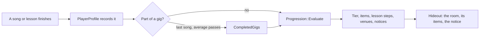

# Hideout and Progression

> Verified against the working tree on 2026-11-18 (game commit 7653067 plus the uncommitted hideout work). Engine submodule at 1f558fd1. Headless (lavapipe) captures and unit tests only: nothing here has been played with sticks or heard on speakers yet.

The main menu is a room, the hideout. It starts as a basement and moves up to a garage, a rehearsal space and a studio as the player plays gigs. A label floats over each thing in the room: the kit plays a song, the practice pad opens the lessons, and so on. What the player has done is kept in a profile. Data-driven rules turn that record into a room, items, lessons and venues. Library songs are never locked.

## Overview

Four pieces, each usable without the next:

1. **The record** (`PlayerProfile`, `Docs/Game-Architecture.md` → Player profile): each song's bests and each lesson's results, saved in `Profile.json` when a run finishes.
2. **The rules** (`Progression`, `Assets/Progression/Progression.json`): rooms (tiers), gigs, the lesson ladder, milestones, items and venue gates. `Progression::Evaluate` turns the record into unlocks and queues a notice for each new one.
3. **Gigs** (`GigSession`): a short setlist from the player's own library, played back to back at the gig's venue. Its average accuracy decides whether it is completed, and completing one moves the hideout up.
4. **The room** (`Hideout`, `Assets/Hideout/*.lvl`): the tier's scene, loaded behind the main menu. It shows unlocked items, labels the stations, flies the camera to the one picked, and plays the menu music as the radio in the room would.

## Key Files

| Path | Role |
|------|------|
| `Game/Source/Config/PlayerProfile.h/.cpp` | The record and `Profile.json` |
| `Game/Source/CoreGame/Progression.h/.cpp` | The rules: loading, `Holds`, `Evaluate`, lesson and venue gates, `Setlist` |
| `Assets/Progression/Progression.json` | The journey itself: tiers, gigs, lesson steps, milestones, items, venue gates |
| `Game/Source/CoreGame/GigSession.h/.cpp` | The gig being played |
| `Game/Source/Hideout/Hideout.h/.cpp` | The room behind the main menu |
| `Game/Source/Components/Hideout/HideoutMarkers.h/.cpp` | `HideoutStation`, `HideoutItemSlot`, `HideoutView` |
| `Assets/Hideout/Basement.lvl`, `Garage.lvl`, `Rehearsal.lvl`, `Studio.lvl` | The rooms (generated) |
| `Tools/Hideout/make_hideout.py` | Writes the rooms with `Tools/Venues/venuegen.py`; the basement comes from `Tools/Hideout/basement.py`, helpers from `Tools/Hideout/hideoutgen.py` |
| `Tools/Hideout/make_textures.py` | Draws `Assets/Hideout/Textures/*.png` with ImageMagick: concrete, wood, cardboard, egg cartons, the banner, the posters, the flyers, the screens |
| `Tools/Hideout/make_sounds.py` | Synthesises the room tone in `Assets/Hideout/Sounds/*.wav` with ffmpeg |
| `Assets/MainMenu.lvl` | The menu camera, with the room's `PostProcess` |
| `Game/Tests/Source/PlayerProfileTests.cpp`, `ProgressionTests.cpp` | The record, the rules, the shipped journey, setlists, gigs, venue gating |

## How It Works

### The rules

`Progression.json` has six lists. A `Requires` object can sit on anything and holds when every field it sets holds:

| Field | Holds when |
|-------|-----------|
| `Tier` | the hideout is at that tier or above |
| `Gigs` | those gigs are completed |
| `LessonSteps` | every lesson of those ladder steps has passed |
| `LessonsPassed`, `SongsPlayed`, `FullCombos` | the profile counts at least that many (different songs) |
| `SongsAtAccuracy` + `Accuracy` | that many songs have a best accuracy of at least that |

- **Tiers** are the rooms in order, each with its `Scene` and `Rewards` (item ids). The first needs nothing. The hideout moves to the highest tier whose requirement holds, and never moves back down.
- **Gigs**: `Venue` (a registry id such as `Backyard`, or a room name `Club` / `Festival` / `Arena`), `Songs`, a notes-per-second range (`MinNotesPerSecond`, `MaxNotesPerSecond`; `m_noteCount / m_duration`, a stand-in for difficulty since charts carry no rating), optional `SongKeys` (song folders to use first), `PassAccuracy` and `Rewards`.
- **LessonSteps**: the ladder. A step's `Lessons` (practice lesson ids) open together when its requirement holds. A step with no requirement is open from the start. Passing every lesson in a step gives its `Rewards`. The shipped ladder covers all 16 lessons, and a test checks that.
- **Milestones**: a requirement and `Rewards`.
- **Items**: `Id`, `Name`, `Description`, and `Slot`, the `HideoutItemSlot` that shows it.
- **Venues**: free play's gates. A venue with no gate is always open.

`Evaluate` loops until nothing changes, so one unlock can lead to another (a gig moves the tier up, which opens the next gig). Each unlock goes into `PlayerProfile::UnlockedItems` as `kind:id` (`tier:garage`, `item:practice-pad`, `step:grooves-1`, `lessons:rudiments-1`, `milestone:first-song`, `gig:club-night`, `venue:Club`), so it is announced once. Its text is also queued on `PlayerProfile::Notices`. It runs after every recorded result (`NoteHighwayCore::RecordResult`, which shows the new unlocks on the results screen) and when the hideout loads, which also gives a new player the first room's rewards.

`--unlock-all` (`Progression::UnlockAll`) opens every lesson, gig, venue and item, without touching the profile. A missing or broken `Progression.json` also opens everything, with a log line.

### Lessons

`Progression::LessonOpen`: a lesson in no step is open; one in a step opens with the step. A lesson already passed stays open, and so does one marked `lesson:<id>` in the profile (kept for unlocking a lesson from a song, which isn't built). The practice page tags each row PASSED or LOCKED. The details say what passing takes, or which step opens the lesson. START is hidden for a locked lesson, and `PracticeMenuController::StartLesson` refuses one. `--practice` from the command line is not gated.

### Venues in free play

`ChooseVenue` (`Docs/Venue-Authoring.md` → How a venue is chosen) gets two inputs. `GigVenue`, the gig's venue, comes after `--venue` / `--venue-style` and before everything else. `VenueOpen` gates the player's picks: the player's `VenueId` is skipped when locked, and a locked `VenueStyle` room (or a Random pick of one) falls back to an open room, or else the first open, non-hidden scene. `ChooseForSong` fills both from `VenueRegistry::GigVenue()` and `Progression::VenueOpen`. A song's own venue and the command line are not gated, and neither is anything in a run started with `--play-track` (headless captures keep the setting's venue). With the shipped gates a new player gets the Backyard until Club Night is played.

### Gigs

The gig board lists every gig: its description, venue, length and pass mark. An open one also shows its setlist and PLAY THE GIG. `Progression::Setlist` takes the gig's `SongKeys` first, then songs ordered by how far their notes-per-second falls outside the range (0 inside it, rounded to half a note a second). Within the same distance the order comes from an FNV hash of the gig id and the song folder, so the same library always gives the same set. One copy of each title is used (a library can hold a song twice). Songs with no notes are left out.

`GigSession::Begin` sets the venue (`VenueRegistry::GigVenue()`) and `LaunchCurrent` loads the gameplay scene with the first song (`TrackRadioUtils::LaunchTrack`). Each recorded song keeps its best accuracy this gig, so a Retry can only raise it. When every song has been recorded, the set's average against `PassAccuracy` decides. A pass adds the gig to `CompletedGigs`, then `Evaluate` runs. The results screen shows the gig and song number (`gig`, `gig_name`, `gig_progress`), NEXT SONG while songs remain (`gig_next`), the set's verdict on the last one (`gig_result`), and BACK TO THE HIDEOUT. Escape on the results moves on the same way. Exit from the pause menu, or BACK TO THE HIDEOUT, abandons the gig (`InGameMenuController::LeaveGig`). Loading the hideout ends any gig still open.

`--gig <id> [--gig-songs N]` starts a gig as the hideout loads, for headless checks. With `--highway-autoplay --record-autoplay` the songs count.

### The room

`MainMenuController` owns a `Hideout` and starts it on its first update, under the menu's own camera entity. `Hideout::Start` reads the tier's scene (`--hideout-room <path>` overrides it) and instances it as a prefab is: fresh GUIDs, no cores. It then walks the entities:

- `HideoutView`: where the overview camera stands. It looks along local +Z with its `FieldOfView`.
- `HideoutStation`: `Station` (Kit, PracticePad, Radio, Laptop, TrophyWall, Mixer, GigBoard, Door), an optional `Label`, and `ViewOffset` / `FieldOfView` for the camera once it is picked. The entity's position is what the camera looks at.
- `HideoutItemSlot`: `Slot`. If an item names the slot and isn't unlocked, the entity and its children are deleted. A slot no item names stays.

Each frame `Hideout::Update` eases the camera toward the overview or the chosen station, with a slow sway in the overview. Picked, the camera aims a little left of the station so it sits in the part of the screen the panel leaves open. Each station's position is projected through the camera (`GetProjectionMatrix() * WorldToCamera`, one frame behind) into the `stations` list as percentages, kept clear of the screen edges, for the labels in `MainMenu.rml`. Picking a station flies the camera there. Once it has nearly arrived (at least 0.35 s, at most 1.2 s), the station acts: Kit loads the library, PracticePad the lessons, Laptop the DLC page, Mixer opens the settings panel (closing it returns to the overview), Radio shows the radio widget, TrophyWall and GigBoard open their panels (`hideout_panel`), and Door quits. Escape leaves a station or dismisses the notice. The header shows the room, its description and the next goal (`Hideout::NextGoal`). Notices queued since the last visit show once as *While you were out*, then are cleared from the profile.

The page binds `hideout`, `hideout_focus`, `hideout_room`, `hideout_room_text`, `hideout_goal`, `hideout_panel`, `hideout_notice`, `hideout_title`, `hideout_hint`, `hideout_status` and the lists `stations`, `records` and `gigs`. `Hideout::RegisterModel` sets them all before the first update. Events: `station(i)`, `hideout_back`, `dismiss_notice`, `gig_play(i)`. With no room (no tier scene, or one that can't be read) `hideout` stays 0 and the old flat menu shows.

`--hideout-station N` starts at station N, its action included; `--hideout-look N` only frames it. Both are for headless captures. Stations are numbered in entity order, which the log lists at start (`[Hideout] station N: LABEL`). `--width 1600 --height 900` captures at 16:9, as most players see it.

### The basement

The first room is dressed in full (`Tools/Hideout/basement.py`): an unfinished basement of painted concrete block with open joists, pink insulation, a duct and copper pipe, a lally column, the stairs up to the kitchen (its light spilling down), a window well with a streetlight spot shining through it into the haze, and dust in the beam. Its items:
- The kit is Band's real kit with the player's drummer at it (below), and a "BAND NAME TBD" logo on the kick.
- A spray-painted bedsheet hangs behind the kit, among egg cartons stapled up as soundproofing, with Christmas lights along the wall.
- Bucket drums from before the kit, a box fan on a milk crate, a setlist taped to the floor, and a guitar leaning on the amp.
- The couch has the cat asleep on it (breathing, its tail flicking), with the boombox over it, a CRT with rabbit ears and static on a milk crate, and a space heater.
- The furnace (with its pilot light) and the water heater stand in the corner.
- The workbench has a pegboard, a desk lamp, a dying fluorescent tube, a phone book taped up as a practice pad, magazines and a can of sticks. Next to it are the mini fridge and the gig board, carrying a "BASSIST WANTED" and a "LAWNS MOWED" flyer.
- The trophy wall holds a 7th-grade certificate and a participation ribbon.
- There are posters for bands that don't exist, a rudiment chart typed from `Lessons.json`, a calendar, a clock, laundry on a line, a beanbag, pizza boxes and cans.
- The room tone is the furnace's rumble, the tube's buzz, the fan and a drip, all looping 3D `AudioSource`s.

Every item slot of `Progression.json` has a place in it too.

### The garage

The second room (`Tools/Hideout/garage.py`) is the same story a step on: the kit has moved into the parents' garage after the first gig. It has painted drywall and the roll-up door propped open a foot behind the drummer, with the streetlight coming in under it into the haze and a car's lights now and then. There are the opener's light, party lights chasing the beat and two shop lights. It also holds the bench with a vise and the real practice pad's place, the lawnmower that paid for the cymbals, a bike, the paint shelves, the couch and the cat, the boombox, the CRT on a cooler with mom's camcorder still filming, a dartboard, a soda fridge, and the house door open on the kitchen light. The bedsheet hangs off the door tracks. The rehearsal space and the studio are still the greybox of `make_hideout.py`'s `build_room`, with the drummer in place of their primitive kit.

### The band's name

`PlayerProfile::BandName` is empty until the player names the band from the link under the hideout's goal (`band_name_edit`; the panel's input is `band_name_input`, saved with `band_name_save`, up to 28 characters). `HideoutBandName` marks what shows it: `Unnamed` parts (the "BAND NAME TBD" bedsheet and kick head) show while it's empty, and `Named` parts (a blank sheet and head, and `TextRenderer`s whose `Text` becomes the name in capitals, shrunk past `FitLetters` letters) show once it isn't. Parts are hidden by scale, so a rename applies at once (`Hideout::ApplyBandName`). The text is the engine's Inter, drawn three times a hair apart for a heavier stroke.

**Motion (`HideoutMotion`).** A prop moves around how the scene left it, every frame (`Hideout::UpdateMotions`). The kinds:
- `Sway` swings about `Axis` (a hanging bulb, the laundry, the metronome's arm).
- `Flicker` dips the light at random (the dying tube, the TV, the pilot light).
- `Pulse` swells and fades.
- `Spin` turns (the fan).
- `Breathe` scales (the cat).
- `Blink` (the smoke detector).
- `Bob` moves along `Axis` (the boombox's speaker cones).

Each acts on the entity's `Light`, on its own mesh's emissive (a `StandardMaterial` set through its setters), or on its transform. With `Music`, `Sway`, `Pulse` and `Bob` follow the radio instead of a clock. The clock (`Hideout::UpdateMusic`) reads the playing song's beat grid from its `NoteData.txt` (the database's `TrackData` doesn't load notes until the song is played) at `TrackRadio::GetPositionMS`. An envelope peaks on each beat, harder on a bar's first and in a loud passage; loudness comes from `TrackRadio::GetLevel` (FMOD metering of the pack's group, `AudioPack::GetLevel`). A `Pulse` with `Phase` above 0 fires on one beat in four (`Phase * 4`): the Christmas lights chase along the string. Give an animated entity an identity rotation: its base rotation comes back from its quaternion as whichever Euler angles it likes, and the motion is added to those.

**The drummer (`HideoutDrummer`).** At the marker (the throne; `Yaw` 180 faces -z, a field because the same Euler problem applies) the hideout builds a `Band` with only the drums present, through its own `VenueKit` and an empty stage group. It rebuilds it for each song the radio plays, from a copy of that song's `TrackData` with its notes loaded, and updates it with the radio's position. So the player's drummer plays along with the radio, and sits idle at the kit between songs. `Band::CastSeed` (the marker's `Cast`) keeps the same character whatever the song. The stage sits 50 m under the floor until `Band::BodiesReady` (the rigged model has loaded), so the drummer never shows in his T-pose.

**Arriving, pointing, unlocking.** The first time the menu opens in a session, the camera starts at `HideoutView.IntroEye` (the basement: the top of the stairs) and glides to the overview over 4.5 s (smootherstep), the labels held back until it's there; `--no-hideout-intro` and the capture flags skip it. Pointing at a label (or focusing it) fades up a soft light over its station (`station_hover`), and the overview leans a little toward the pointer. Items unlocked since the last visit (`PlayerProfile::NewItems`, filled by `Progression::Evaluate`) get a tour once the notice is dismissed: the camera visits each one for 2.6 s from the middle of the room's side of it, lit, with "NEW: <name>" on a note (`hideout_reveal`); Escape skips it.

**More life in the basement.** `HideoutMotion` `Pass` sweeps a light along its axis every so often (a car's headlights across the ceiling through the window well). A camcorder on a tripod by the kit is a `Camera` rendering into `Assets/Hideout/Camcorder.rendertexture` every fourth frame with no AO, volumetrics or sun shadows; the CRT's screen shows it (its Diffuse and Emissive), so the TV plays the drummer live.

**The camera's look.** The menu camera (`Assets/MainMenu.lvl`) carries a `PostProcess`:
- AgX tone mapping, bloom, SSAO, film grain, vignette, a little lens fringe, and a light share of the `Warm` LUT.
- Fog and volumetric fog (for the window's beam). Lights opt in with `VolumetricMultiplier`.
- Depth of field. `Hideout::UpdateFocus` keeps `DoFFocusDistance` on what the camera is looking at.

The overview is framed for 16:9; a narrower window widens its vertical field of view (`FitToWindow`, up to 100 degrees) so the stations at the sides stay in the picture. The labels are pushed apart where they would overlap (`Hideout::UpdateLabels`, about 19% by 7% of the screen each), and each is tilted a few degrees (`tilt`). In the basement (`hideout_tier` 0, the page's `basement` class) they are strips of masking tape, the header a piece of cardboard and the notice a sticky note.

### The radio in the room

`Hideout::ApplyRadio` calls `TrackRadio::SetSpeaker( open, pan, level )` every frame. The radio keeps those values across songs and applies them to each pack (`AudioPack::SetSpeaker`). The effect is a multiband EQ DSP at the tail of the pack's channel group (a 24 dB high-pass and low-pass, from about 300 Hz to 3 kHz when shut, widened on a log scale to 20 Hz to 20 kHz when open, and bypassed when fully open), the group's pan, and its volume. Across the room `open` is at most 0.35, more as the camera nears the radio. Picking the radio eases it to 1 and the pan to the centre. The level goes from 0.7 to 1. The `Hideout` destructor (leaving the main menu) sets 1, 0, 1, which takes the effect off. This is not FMOD 3D positioning: the pan is worked out from the camera and the radio, on the stems' existing 2D group.

## How to Extend

**A gig, an item, a lesson step, a milestone, a venue gate:** add it to `Progression.json`. No code. The shipped-journey test (`ProgressionTests.cpp`) checks that names resolve and that every gig opens when played straight through.

**A room:** edit `Tools/Hideout/make_hideout.py` (`ROOMS`: size, colours, light, the drum shells' colour, and an `extras` function for the room's own things), run it, and point a tier's `Scene` at the file. A hand-made room in Havana works too: it needs a `HideoutView`, the stations, and an item slot for each item slot name.

**A station kind:** add it to `HideoutStation::Kind` (and its reflect enum), name it in `KindName` / `KindHint` in `Hideout.cpp`, and act on it in `Hideout::Update`.

## Caveats & Fragility

- **Nothing has been played or heard.** Gig flow, lesson passing and the radio's filter were checked with autoplay and unit tests. Camera moves, label clicks and the sound of the radio need a person.
- **Only the basement is dressed**; the garage, rehearsal space and studio are greyboxes of primitives. All the lighting is tuned on lavapipe captures only.
- **A room needs a shadow-casting ceiling.** A scene with no directional light gets the engine's sun. Through joists alone, with a subfloor that casts no shadows, it falls across the room in stripes. Every generated room's ceiling casts shadows now.
- **The drummer is rebuilt for every radio song** (`Band::Build` loads the chart's notes on the main thread), so there may be a hitch at each change of song. Measure it on hardware.
- **The room tone hasn't been heard**: headless runs play silently.
- **Gig difficulty is notes per second**, which says little about how hard a chart is.
- **Gating the venue changes free play for everyone with no profile**: a fresh profile gets the Backyard until Club Night, whatever the Venue setting says. `--unlock-all` lifts it. The Venue tab still lists every venue and doesn't mark locked ones.
- **Autoplay, no-fail and skipped-ahead runs don't count**, so a gig can't be passed with autoplay unless `--record-autoplay` is given.
- **Labels can overlap** when two stations line up from the camera. Picking either still works.
- **Lesson ↔ song pattern links** (unlocking a lesson from a song that has its pattern, showing the sticking on the song's highway) are not built. Only the `lesson:<id>` unlock key is ready for them.

## Related Docs

- `Docs/Game-Architecture.md` → Player profile
- `Docs/Practice.md` → Passing
- `Docs/UI-and-Menus.md` (the main menu page)
- `Docs/Venue-Authoring.md` (how a venue is chosen; the scene format the rooms share)
- `Docs/Audio.md` (`TrackRadio`, `AudioPack`)
