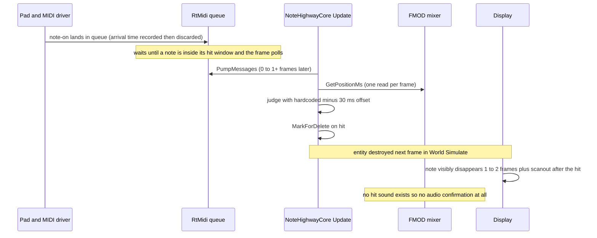

# Latency and Responsiveness

> Verified against game commit 1714270, 2026-07-10. Engine submodule at 047f57b8.

The end-to-end timing story: every stage between a stick hitting a pad and the game responding, which clock each stage runs on, what compensation exists today, and the engine constraints that bound any fix. Facts only — the ranked improvement plan lives in `Docs/State-of-the-Game.md`.

## Overview

Drumsmith's hit judgment runs entirely inside `NoteHighwayCore::Update`, once per rendered frame, comparing MIDI/keyboard input polled *at that moment* against an FMOD stream position read *at that moment*. Nothing in the chain carries a timestamp: input arrival times are discarded at the RtMidi boundary, and the judge clock is sampled once per frame. The engine loop is variable-timestep with vsync permanently on, so every stage is quantized to display refresh. There is currently **no audio feedback for a hit** and visual feedback lands 1–2 frames after judgment.

## Key Files

| Path | Role |
|------|------|
| `Game/Source/Cores/NoteHighwayCore.cpp` | Poll + judge + feedback, all in `Update` |
| `Game/Source/Midi/MidiDevice.cpp` | `PumpMessages` — where timestamps are lost |
| `Game/Source/CoreGame/AudioPack.cpp` | `GetPositionMs` (judge clock), DSP-clock start scheduling |
| `Engine/Source/Engine/Engine.cpp` | `Engine::Run` — the frame phase order below |
| `Engine/Modules/Moonlight/Source/Renderer.cpp` | `BGFX_RESET_VSYNC` (unconditional) |
| `Engine/Source/Cores/AudioCore.cpp` | FMOD init (default mixer settings) + per-frame `System::update` |

## How It Works

### Frame phase order (engine loop, `Engine::Run`)

Per frame, in order: `ParseMessageQueue` (SDL pump → key events) → `FirePendingEvents` (queued events, e.g. `LoadSceneEvent`) → `GameClock.Update` → `Input::Update` (keyboard/mouse state) → `World::Simulate` (entity/core reconciliation **and destruction of entities marked last frame**) → `UpdateLoadedCores` (**`NoteHighwayCore::Update` runs here**) → `Game::OnUpdate` → `AudioThread->Update` (FMOD `System::update`) → LateUpdate block (cameras, UI) → `UI::Render` + `BGFXRenderer::Render` → input `PostUpdate`. Variable timestep; the fixed-step remnants are disabled (`Engine/Docs/Architecture.md`). Vsync is always on — frame duration is a display-refresh multiple (16.7 ms at 60 Hz, 6.9 ms at 144 Hz).

### The chain, stage by stage

| Stage | Added latency | Notes |
|-------|---------------|-------|
| Pad sensor → USB → OS MIDI driver | ~1–5 ms (typical, external) | Module-dependent; e-drum modules add their own scan time |
| Driver → RtMidi internal queue | <1 ms | RtMidi's backend thread stamps arrival — the stamp is then discarded by `PumpMessages` |
| Queue → game code | **0 ms to unbounded** | Pumped only inside the per-note loop, only when a note is already in its window and keyboard didn't hit; otherwise messages sit (see `Docs/Gameplay-Note-Highway.md`). Best case within a window: 0–1 frame (0–16.7 ms at 60 Hz) |
| Judge clock staleness | 0–1 frame + FMOD granularity | `GetPositionMs` read once at update start; FMOD stream position resolution depends on mixer settings (defaults — verify via `System::getDSPBufferSize`) |
| Visual feedback | 1–2 frames + display | `MarkForDelete` (frame N) → `World::Simulate` destroys (frame N+1) → present (vsync) → scanout |
| Audio feedback | **∞** | No gameplay hit sound; `Drumset` is dormant even in the editor (`Docs/Audio.md`) |

Order-of-magnitude totals at 60 Hz: a perfectly timed hit is *judged* ~5–25 ms after the physical strike and *visibly confirmed* ~40–60 ms after it, with no audio confirmation. At 144 Hz the poll and visual terms shrink proportionally. These are derivations from the mechanics above, not measurements — see "How to measure".

### Clock inventory

| Clock | Where | Used for | Character |
|-------|-------|----------|-----------|
| FMOD channel position (`GetPositionMs`, stem 0) | `AudioPack::GetPositionMs` | **The judge clock** and highway scroll target | Millisecond units; granularity tied to FMOD internals; returns 0 on channel error; moves relative to other stems after pause/seek (`Docs/Audio.md`) |
| FMOD DSP clock (`getDSPClock`) | `AudioPack::Play` only | Sample-accurate synchronized *start* (+2048 samples) | Sample-accurate; not consulted after start |
| Engine `GameClock` (`std::chrono::high_resolution_clock`) | `UpdateContext::GetDeltaTime` | Camera smoothing, radio state machine | Variable per-frame delta; never correlated with the audio clock |
| RtMidi per-message delta time | `RtMidiIn::getMessage` return | **Discarded** in `MidiDevice::PumpMessages` | The only record of input arrival time; `MidiMessageNew` has no field for it |
| OS monotonic time | — | Unused by game code | Would be needed to correlate input stamps with audio position |

### Compensation state today

- `int globalOffsetMs = -30` hardcoded in `NoteHighwayCore::Update` — shifts the judge clock earlier by 30 ms, presumably tuned on one machine.
- `GameSettings::AudioLatency` / `VideoLatency`: settable from the settings UI (which now reads them back), persisted in `Settings.json`, **read by nothing** (`Docs/Game-Architecture.md`).
- The main menu's visual latency test measures keyboard-vs-marker offsets in **milliseconds** and can copy its average into `VideoLatency`, which nothing consumes (`Docs/UI-and-Menus.md`).
- Hit window: effectively fixed ±50 ms for all real content (the `noteSpeed` scaling is self-neutralizing — `Docs/Gameplay-Note-Highway.md`).
- Chart-side: notes recorded in the `TrackEditor` inherit the full input→UI-frame latency at authoring time, silently baking the charter's setup latency into `NoteData.txt` (`Docs/Songs-and-DLC.md`).

### Engine constraints on any fix

Each constraint links the doc that states it:

- **Main-thread-only**: `EventManager`, `World` (entity create/destroy), `ResourceCache`, and bgfx submission must stay on the main thread (`Engine/CLAUDE.md` hard rules; `Engine/Docs/Jobs-and-Events.md`). A MIDI callback thread therefore may **not** touch note entities, fire events, or load resources — it can only enqueue into a queue the main thread drains.
- **Events are synchronous and not thread-safe** (`Engine/Docs/Jobs-and-Events.md`) — no cross-thread event delivery exists.
- **FMOD Core API is thread-safe** as initialized (`FMOD_INIT_NORMAL`, no `FMOD_INIT_THREAD_UNSAFE` — `Engine/Source/Cores/AudioCore.cpp`), so `System::playSound` on preloaded `FMOD_CREATESAMPLE` sounds is legal from a non-main thread. Preloading itself must happen on the main thread if it goes through `ResourceCache`; `Drumset::loadSound` uses raw FMOD and carries no such restriction, but is main-thread today.
- **Vsync is not optional**: `BGFX_RESET_VSYNC` is set unconditionally in `Renderer.cpp` — the poll cadence floor is the display refresh, and there is no frame-rate cap logic beyond it (the `FPS = 144` constant in `Engine/Source/Engine/Engine.h` is unused).
- **Variable timestep**: no fixed-tick simulation exists to decouple judgment cadence from render cadence (`Engine/Docs/Architecture.md`; fixed timestep is a stated engine priority motivated by this game).
- **Menus are RmlUi documents composited every frame** (`Engine/Docs/UI-RmlUi-and-ImGui.md`) — UI-side feedback (combo counters etc.) no longer has a 60 fps cap, but model values reach the screen on the frame after they are set.
- **`CameraCore` updates in LateUpdate** (`Engine/Docs/Architecture.md`) — camera-dependent visuals computed in `Update` see last frame's camera.

### How to measure (re-stamp numbers before relying on them)

- `System::getDSPBufferSize` / `getSoftwareFormat` at runtime for the actual mixer block/count and sample rate.
- The existing `BRUH_FMT("Pressed: difference = %f ms ...")` log in `NoteHighwayCore::Update` prints per-hit judgment offsets — a real-hardware histogram source as-is.
- Optick captures (F9; parsing recipe in `CLAUDE.md`) for frame-time distribution and update-phase costs.
- Ground truth requires a physical loopback: record pad strike audio and game audio output on one device and measure the gap (the standard rhythm-game calibration method).

## Caveats & Fragility

- Every number in the budget table above is a *derivation* from code structure, except the mechanics themselves; hardware terms are typical figures. Do not quote totals as measurements.
- The stale-queue behavior means the *effective* input latency distribution is bimodal: near-frame-latency when notes are dense, and arbitrarily wrong (stale hits consumed late) after gaps — a histogram from the `BRUH_FMT` log will look better than the experience feels.
- The judge clock and the scroll position are the same FMOD read, but the highway applies exponential smoothing (`smoothFactor = 10`) — what the player *sees* is intentionally behind what the judge *uses*, by roughly `1/smoothFactor` seconds of convergence lag after any tempo/seek discontinuity.

## Related Docs

- `Docs/State-of-the-Game.md` — the ranked plan to fix all of this
- `Docs/Gameplay-Note-Highway.md` — the judgment code in detail
- `Docs/MIDI-and-Pads.md` — the input boundary
- `Docs/Audio.md` — FMOD facts, the dormant hit-sound path
- `Engine/Docs/Jobs-and-Events.md`, `Engine/Docs/Architecture.md` — the threading and frame-loop rulebooks
