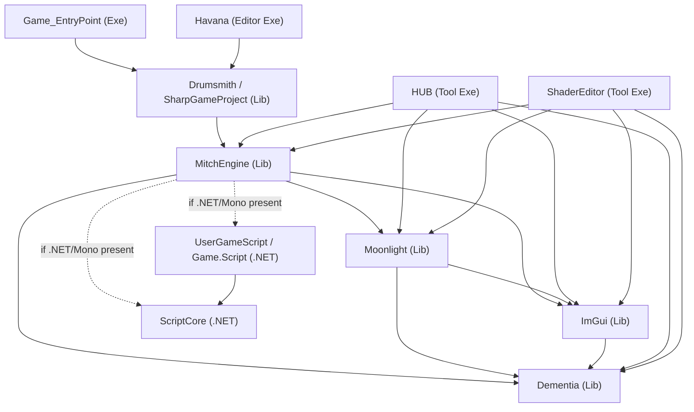

# Sharpmake Dependency Hierarchy

Generated from the `*.sharpmake.cs` project/solution definitions. Two things are
tracked here:

- **Link/build dependencies** — declared via `conf.AddPublicDependency<T>()`.
- **Class inheritance** — the C# base class each Sharpmake project derives from
  (this is *config* inheritance, not a link dependency).

Project **class name** → **output binary name** where they differ:

| Class | Binary `Name` | Output |
|-------|---------------|--------|
| `SharpGameProject` | `Drumsmith` | Lib |
| `Engine` | `MitchEngine` | Lib |
| `EntryPointGameProject` | `Game_EntryPoint` | Exe |
| `EntryPointGameProjectUWP` | `Game_EntryPoint_UWP` | Exe (UWP) |
| `Havana` | `Havana` | Exe (editor) |
| `MitchHubProject` | `HUB` | Exe (tool) |
| `ShaderEditor` | `ShaderEditor` | Exe (tool) |
| `Moonlight` / `ImGui` / `Dementia` | *(same)* | Lib |
| `ScriptCore` / `UserGameScript` | `ScriptCore` / `Game.Script` | .NET class lib |

---

## Runtime / Link Dependency Graph



### Foundation-up order

`Dementia` → `ImGui` → `Moonlight` → `MitchEngine` → `Drumsmith` → `Game_EntryPoint`

This matches the build target chain noted in `CLAUDE.md`
(`Dementia → MitchEngine → Moonlight, ImGui, Havana, MitchGame → Game_EntryPoint`).

---

## Per-Project Dependencies

Explicit `AddPublicDependency<T>()` calls only (not transitive):

| Project | Depends on |
|---------|------------|
| `Dementia` | *(none — leaf)* |
| `ImGui` | `Dementia` |
| `Moonlight` | `Dementia`, `ImGui` |
| `Engine` (`MitchEngine`) | `Moonlight`, `Dementia`, `ImGui`, **+** `ScriptCore`, `UserGameScript` *(conditional)* |
| `SharpGameProject` (`Drumsmith`) | `Engine` *(inherited from `BaseGameProject`)* |
| `EntryPointGameProject` | `SharpGameProject` |
| `EntryPointGameProjectUWP` | `SharpGameProject` *(inherited)* |
| `Havana` | `SharpGameProject` |
| `BaseTool` | `Dementia`, `Moonlight`, `Engine`, `ImGui` |
| `MitchHubProject` (`HUB`) | *(inherits `BaseTool`'s deps)* |
| `ShaderEditor` | *(inherits `BaseTool`'s deps)* |
| `GameScript` | `ScriptCore` |
| `UserGameScript` | `ScriptCore` *(inherited)* |
| `ScriptCore` | *(none — leaf)* |
| `Mono` | *(none; currently unused / commented out of `Engine`)* |

> **Conditional Engine deps:** `ScriptCore` + `UserGameScript` are only added when the
> platform is **not mac** and a .NET/Mono host dir exists
> (`MONO_macOS_Dir`, `MONO_Win64_Dir`, `DOTNET_Win64_Dir`, or `DOTNET_Linux_Dir`).

---

## Class Inheritance Tree

```
Sharpmake.Project
└── BaseProject                (abstract; ConfigureAll/Win64/UWP/Mac/Linux, targets)
    ├── BaseGameProject        (abstract; adds Engine dep)
    │   └── SharpGameProject   → "Drumsmith"
    ├── EntryPointGameProject  → "Game_EntryPoint"
    │   └── EntryPointGameProjectUWP → "Game_EntryPoint_UWP"
    ├── Engine                 → "MitchEngine"
    ├── Moonlight
    ├── ImGui
    ├── Dementia
    ├── Havana
    ├── Mono
    └── BaseTool               (adds Dementia/Moonlight/Engine/ImGui deps)
        ├── MitchHubProject    → "HUB"
        └── ShaderEditor

Sharpmake.CSharpProject
├── ScriptCore                 (.NET 8 class lib)
├── GameScript                 (abstract)
│   └── UserGameScript         → "Game.Script"
└── SharpmakeProjectBase
    └── UserSharpmakeProject
```

---

## Third-Party Libraries by Project

Statically linked / referenced third-party libs (from the `Configure*` overrides):

| Project | Third-party |
|---------|-------------|
| `Dementia` | Bullet, glm, JSON (nlohmann), Optick (non-Linux) / ChromeTrace (Linux), ImGui headers |
| `ImGui` | ImGui, SDL2 (headers) |
| `Moonlight` | bgfx, bx, bimg, bimg_decode, Assimp |
| `Engine` | SDL2, Assimp, zlib, RmlUi + FreeType, Bullet3D, FMOD *(optional)*, .NET host (`nethost`/`hostfxr`) *(optional)*, Mono *(legacy/optional)*, Dwrite (Win) |
| `SharpGameProject` (`Drumsmith`) | rtmidi, midifile, USB-MIDI; `winmm`/`winhttp` (Win), `curl` (Mac/Linux), `libasound` (Linux) |

---

## Solutions

### `SharpGameSolution` → `Drumsmith.sln` (extends `BaseGameSolution`)

Projects added per target:

- Always: `Dementia`, `ImGui`, `Moonlight`, `Engine`, `SharpGameProject`
- **Editor mode:** `Havana`, `MitchHubProject`, `ShaderEditor`
- **Game mode:** `EntryPointGameProject` (or `EntryPointGameProjectUWP` on UWP)
- Win64 only: `UserSharpmakeProject`
- If .NET/Mono present (non-mac): `UserGameScript`, `ScriptCore`

### `BaseScriptSolution` → `GameScript.sln`

- If .NET/Mono present (non-mac): `UserGameScript`, `ScriptCore`

---

## Notes

- `Mono` (`ThirdParty/Mono.sharpmake.cs`) is defined but its `AddPublicDependency`
  in `Engine` is commented out — the scripting path now uses .NET 8 via `ScriptCore`.
- All deps are declared **public**, so link requirements propagate transitively
  (e.g. `Game_EntryPoint` transitively pulls in `Dementia` through `Drumsmith → Engine`).
- On Linux the static-lib link order is instead hand-rolled via
  `AdditionalLinkerOptions` (`-l:libDementia.a`, `-l:libMoonlight.a`, …) in
  `BaseProject.ConfigureLinux` / `Engine.ConfigureLinux`.
