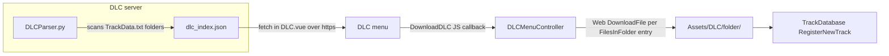

# Songs and DLC

> Verified against game commit 1714270, 2026-07-10. Engine submodule at 047f57b8.

Everything about song content: the on-disk format, how charts are parsed out of Rock Band-style `notes.mid` files, the `TrackDatabase` that feeds the menus, the DLC download flow, and the in-editor track editor used to author/record charts.

## Overview

A song is a folder under `Assets/DLC/` containing audio stems, a MIDI chart, and two JSON sidecars (`TrackData.txt` metadata, `NoteData.txt` notes). At boot, `TrackDatabase` scans that directory for folders with a `TrackData.txt` and builds the in-memory track list. Songs originate either from the "Convert Custom DLC" pipeline (parsing Rock Band / Clone Hero content: `song.ini` + `notes.mid`) or from recording in the `TrackEditor` widget. A separate server-side Python script builds a `dlc_index.json` that the DLC menu fetches to offer downloads.

## Key Files

| Path | Role |
|------|------|
| `Game/Source/CoreGame/TrackList.h` | `NoteData`, `TrackData`, `TrackList`, `TrackDatabase`, sort/filter enums |
| `Game/Source/CoreGame/TrackList.cpp` | Scan, load/save, legacy conversion, sort/filter implementation |
| `Game/Source/CoreGame/CustomTrackDefineTest.h` | `song.ini` / `.chart` / MIDI parsing singleton (despite the name, this is the production parser) |
| `Game/Source/Editor/TrackEditor.h` | ImGui chart editor widget (`ME_EDITOR` builds only) |
| `Assets/DLC/DLCParser.py` | Server-side generator for `dlc_index.json` |
| `ThirdParty/midifile/` | `smf::MidiFile` MIDI parsing library |

## How It Works

### On-disk song format

`Assets/DLC/<Artist - Title>/` contains:

| File | Required | Purpose |
|------|----------|---------|
| `TrackData.txt` | yes — a folder without it is skipped by the scan | JSON metadata (schema below) |
| `NoteData.txt` | for gameplay | JSON note chart (schema below) |
| `song.ogg` | yes (referenced by `TrackFileName`) | Main mix stem |
| `crowd.ogg`, `drums.ogg`, `drums_1..4.ogg`, `guitar.ogg`, `vocals.ogg`, `rhythm.ogg`, `keys.ogg` | optional | Extra stems, loaded if present (see `Docs/Audio.md`) |
| `notes.mid` | for conversion | Rock Band-style MIDI chart with a `PART DRUMS` track |
| `song.ini` | for conversion | Rock Band/Clone Hero metadata |
| `album.png` / `album.jpg` | conversion asserts if missing | Cover art |

**`TrackData.txt` schema** (written by `TrackData::OnSaveTrackData`): `Title`, `Artist`, `Album`, `Genre`, `Year` (int), `Icon`, `AlbumArtFileName`, `DLCSource`, `NoteSpeed` (float — highway scroll scale), `Duration` (seconds, float), `BPM` (int), `TrackFileName`, `PreviewPercent` (0–1 float, radio preview start), `NoteCount`.

`TrackData::OnLoadTrackData` also accepts legacy keys (`SongName`, `SongArtist`, `AlbumName`), trims leading spaces off every string (the ini parser leaves them in — see Caveats), falls back to `Track.mp3` when `TrackFileName` is missing, and copies `Icon` into `m_dlcSource` when no explicit `DLCSource` exists.

**`NoteData.txt` schema** (written by `TrackData::OnSaveNoteData`): `{ "Notes": [ { "EditorLane": <int PadId>, "NoteName": "snare1", "TriggerTime": <seconds float>, "TriggerTimeMS": <uint>, "Articulation": "Rim", "Velocity": 30 } ], "Beats": [ [ <seconds>, <1 measure / 0 beat> ] ] }`. `Articulation` (Rim, CrossStick, Bell) is omitted when plain and `Velocity` when 100; `Beats` is omitted without a tempo map. On save, notes are sorted by time then lane and deduplicated, and `TriggerTimeMS` is recomputed as `TriggerTime * 1000`. On load (`OnLoadNoteData`), **`NoteName` is authoritative**: the lane is derived via `PadUtils::GetNewPadId(NoteName)` and the JSON `EditorLane` value is ignored.

### The track database

`TrackDatabase` (singleton) scans `Assets/DLC/` in `Reload()` — every subdirectory containing a `TrackData.txt` becomes a `TrackData` entry (its `NoteData.txt` is loaded lazily by `NoteHighwayCore::SetupTrack`, not at scan time). Missing audio logs `YIKES` and skips. `RegisterNewTrack` appends a single folder after a DLC download.

`SortTracks(sort, filter)` builds `m_sortedIndices`: a filter pass matching `m_dlcSource` tags (`"DS"`, `"rb1"`–`"rb4"`, `"rbb"`, `"lrb"`, `"gdrb"`, `"gh5"`, `"gh5dlc"`, `"ghwt"`, `"ghwtdlc"`) then an optional sort by title/artist/year. `GatherFilterCounts` produces per-filter counts for the UI flyout. The UI consumes indices via the menu controllers (`Docs/UI-and-Menus.md`).

`TrackList` inherits the engine's `ConfigFile` pointed at a `TrackDatabase.json` under `Assets/` (not present in the repo), but both `OnSave` and `OnLoadConfig` are empty — the file is vestigial; the directory scan is the only source of truth.

### Chart conversion (`CustomTrackDefineTest`)

Triggered by the settings-menu "Convert Custom DLC" button (or `--convert-dlc` at startup) → `TrackDatabase::ExportMidiTrackMetaData`, which walks `Assets/DLC/` for folders containing `notes.mid`. A folder that already has a `TrackData.txt` is **re-charted**: only `NoteData.txt` is rewritten from `notes.mid` (`TrackData::SaveNoteData`), keeping the metadata. A new folder runs:

1. `ConvertFromLegacy` — parses `song.ini` via `CustomTrackDefineTest::readSongMetaData` (handles UTF-8 BOM; reads `name`, `artist`, `album`, `genre`, `year`, `icon`, `pro_drums`, `song_length` (ms), `preview_start_time`), requires `album.png`/`album.jpg` (`ME_ASSERT`), requires `song.ogg` (Opus is explicitly unsupported — commented out pending FMOD transcoding), and **hardcodes** `m_bpm = 180` and `m_noteSpeed = 10` (the sync-track derivation is commented out). Saves `TrackData.txt`.
2. `CustomTrackDefineTest::ParseMidi` — reads `notes.mid` with `smf::MidiFile` (`doTimeAnalysis` gives absolute seconds per event), finds the track whose name meta-event is exactly `PART DRUMS`, and converts every note-on with pitch 96–100 into a `NoteData`:

| MIDI pitch | `PadId` (via `GetNoteIdFromLegacy`) |
|------------|-------------------------------------|
| 95, 96 | `Bass` (95 is the 2x-kick note) |
| 97 | `Snare` |
| 98 | `ClosedHiHat`, or `HighTom` under a 110 tom marker |
| 99 | `Ride`, or `MidTom` under a 111 tom marker |
| 100 | `Crash1`, or `FloorTom` under a 112 tom marker |

   Rock Band pro drums make yellow, blue and green cymbals unless a tom marker covers the note; a chart with no markers and no `pro_drums` in `song.ini` is read as all toms. With an `[ENABLE_CHART_DYNAMICS]` text event, velocity 1 is a ghost note and 127 an accent. The tempo map becomes the stored beat grid (`ReadMidiBeats`), and the first tempo event the BPM. Rock Band data has no hi-hat open/closed/pedal, rimshots, splash or china; those come from charting in the Track Editor. Returns `false` (folder skipped) when no `PART DRUMS` track exists.

   Files are read through `CustomTrackDefineTest::ReadMidi`, which rewrites running status that continues after a meta event (common in Rock Band exports, rejected by `smf::MidiFile`: it dropped all but two notes of one bundled chart) before parsing.

The `.chart` text-format reader (`readSongFile`) exists but its call sites in `TrackDatabase::Reload` are commented out (`#TODO: Support CHART DLC files`), so `.chart`-only songs are invisible.

### DLC distribution

`Assets/DLC/DLCParser.py` runs server-side over the DLC root and emits an array of `{ Album, Title, Artist, Year, DLCSource, AlbumArtFileName, FolderPath, FilesInFolder }` per song. The DLC page fetches `https://<DLCURL>/dlc_index.json` directly in JS (`Game/ui/src/DLC.vue`); a track's `DownloadDLC` handler (`DLCMenuController::DownloadDLC`) then downloads **every** file listed in `FilesInFolder` via `Web::DownloadFile` into `Assets/DLC/<FolderPath>/` and registers the track. `MainMenuController::SetDLCURL` validates a new server URL by test-downloading its `dlc_index.json` to `Assets/DLC/dlc_index.json` (that local copy is otherwise unused — the menu always fetches over the network).

### Authoring: the Track Editor

`TrackEditor` (`ME_EDITOR` builds, opened via `EditTrackEvent` from the DLC/track-list menus or the editor menu bar) is an ImGui timeline: lanes × time grid with zoom, note snapping controls, a scrubber driven by a preview `AudioSource`, and a pad-preview strip. Charting workflow:

1. Select a track (menu bar or `EditTrackEvent`); notes load from `NoteData.txt` and the preview audio from the track source.
2. Click the timeline to place/remove notes, or **record**: with "Start Recording" active and the preview playing, any bound keyboard key or MIDI note-on appends a `NoteData` stamped with `TrackPreview->GetPositionMs()` at that UI frame. Each input also auditions through `Drumset::hitPad` (see `Docs/Audio.md`).
3. Save writes `TrackData.txt` + `NoteData.txt` via `TrackData::Save` (sorted + deduplicated).

MIDI input in the editor is pumped from the shared `MidiDevice` singleton, only while the editor window is focused (`ImGui::IsWindowFocused`). Unlike gameplay, the editor's note iteration is windowed via a cached `m_closestNoteIndex`.

## Caveats & Fragility

- **`DISABLE_OPTIMIZATION` at file scope** in both `Game/Source/CoreGame/TrackList.cpp` and `Game/Source/CoreGame/CustomTrackDefineTest.cpp` — the entire database scan, JSON load/save, sorting, and MIDI parsing compile without optimization **in every build config**, including release.
- **Hardcoded musical metadata on new conversions**: `ConvertFromLegacy` sets `m_noteSpeed = 10` for every song (BPM now comes from the MIDI tempo map).
- **`song.ini` values keep their leading space** (`artist = Foo Fighters` parses as `" Foo Fighters"`). Only keys are whitespace-stripped; loads compensate with `StringUtils::TrimLeadingSpaces`, and `pro_drums` is compared against the literal `" True"`. Shipping `TrackData.txt` files contain the padded strings.
- **Sort lambdas copy the track list**: the `std::sort` comparators in `TrackDatabase::SortTracks` capture `trackList` **by value** — each sort copies every `TrackData` (with its strings and any loaded `m_noteData`) into the closure.
- **Filter coverage is partial**: `GatherFilterCounts` and `SortTracks` handle different tag sets (`"gh"` and `"rb3dlc"` count but can't be selected; `GuitarHero2/3/4` and `Other` exist in the enum but match nothing) and every unrecognized `DLCSource` logs `YIKES` per track per call.
- **`TrackListFilter`/`DLCSource` matching is exact-string** on tags inherited from `song.ini` `icon` values — one unpadded/odd tag and a track silently lands in no filter bucket.
- **Recording stamps UI-frame time**: recorded notes get `TrackPreview->GetPositionMs()` at ImGui render time — MIDI arrival→frame latency is baked into authored charts (see `Docs/Latency-and-Responsiveness.md`).
- **DLC downloads are unauthenticated plain HTTP(S) file pulls** with no hash/size validation and no partial-download cleanup; a failed multi-file download leaves a half-song folder that the next scan will happily register if `TrackData.txt` arrived.
- **The `TrackDatabase.json` config is dead** (empty `ConfigFile` overrides) but the `TrackList` constructor still attempts to read it from `Assets/` at startup.

## Related Docs

- `Docs/Gameplay-Note-Highway.md` — how `NoteData` becomes gameplay entities
- `Docs/Audio.md` — stem loading (`AudioPack`), editor audition (`Drumset`)
- `Docs/MIDI-and-Pads.md` — `PadId`, `PadUtils` name↔id mapping that `NoteData` relies on
- `Docs/UI-and-Menus.md` — the DLC/track-list menus consuming `TrackDatabase`
