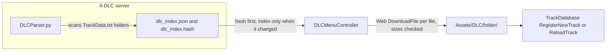

# Songs and DLC

> Verified against game commit 1714270, 2026-07-10. Engine submodule at 047f57b8.
>
> Updated 2026-11-17 against the working tree (the Linear ticket pass, DRU-14 to DRU-54, on game commit 4f29840; engine submodule at c5bb6135): the track database's tag table, removal and chart advice, the whole DLC distribution section, the start marker and F4. The rest is as last verified.
>
> Updated 2026-11-17 on game commit 69fadb1: note 102 in `PART DRUMS` is the hi-hat pedal (`ReadMidiDrumNotes`).

Everything about song content: the on-disk format, how charts are parsed out of Rock Band-style `notes.mid` files, the `TrackDatabase` that feeds the menus, the DLC download flow, and the in-editor track editor used to author/record charts.

## Overview

A song is a folder under `Assets/DLC/` containing audio stems, a MIDI chart, and two JSON sidecars (`TrackData.txt` metadata, `NoteData.txt` notes). At boot, `TrackDatabase` scans that directory for folders with a `TrackData.txt` and builds the in-memory track list. Songs originate either from the "Convert Custom DLC" pipeline (parsing Rock Band / Clone Hero content: `song.ini` + `notes.mid`) or from recording in the `TrackEditor` widget. A separate server-side Python script builds a `dlc_index.json` that the DLC menu fetches to offer downloads.

## Key Files

| Path | Role |
|------|------|
| `Game/Source/CoreGame/TrackList.h` | `NoteData`, `TrackData`, `TrackList`, `TrackDatabase`, sort/filter enums |
| `Game/Source/CoreGame/TrackList.cpp` | Scan, load/save, legacy conversion, sort/filter implementation |
| `Game/Source/CoreGame/CustomTrackDefineTest.h` | `song.ini` / `.chart` / MIDI parsing singleton (despite the name, this is the production parser) |
| `Game/Source/Editor/TrackEditor.h`, `Game/Source/Editor/Chart/` | The chart editor (`ME_EDITOR` builds only): see Authoring |
| `Game/Source/CoreGame/BeatGrid.h` | Beat grid math: snapping, grid lines |
| `Assets/DLC/DLCParser.py` | Server-side generator for `dlc_index.json` and `dlc_index.hash` |
| `Game/Source/CoreGame/ChartAdvice.h` | What a chart asks of the kit (the library's recommendations), and which foot plays each kick |
| `ThirdParty/midifile/` | `smf::MidiFile` MIDI parsing library |

## How It Works

### On-disk song format

`Assets/DLC/<Artist - Title>/` contains:

| File | Required | Purpose |
|------|----------|---------|
| `TrackData.txt` | yes — a folder without it is skipped by the scan | JSON metadata (schema below) |
| `NoteData.txt` | for gameplay | JSON note chart (schema below) |
| `song.ogg` | yes (referenced by `TrackFileName`) | Main mix stem |
| `crowd.ogg`, `drums.ogg`, `drums_1..4.ogg`, `guitar.ogg`, `vocals.ogg`, `rhythm.ogg`, `keys.ogg` | optional | Extra stems, loaded if present (see `Docs/Audio.md`) |
| `notes.mid` | for conversion | Rock Band-style MIDI chart with a `PART DRUMS` track |
| `song.ini` | for conversion | Rock Band/Clone Hero metadata |
| `album.png` / `album.jpg` | conversion asserts if missing | Cover art |

**`TrackData.txt` schema** (written by `TrackData::OnSaveTrackData`): `Title`, `Artist`, `Album`, `Genre`, `Year` (int), `Icon`, `AlbumArtFileName`, `DLCSource`, `NoteSpeed` (float — highway scroll scale), `Duration` (seconds, float), `BPM` (int), `TrackFileName`, `PreviewPercent` (0–1 float, radio preview start), `NoteCount`, and when set `StartTime` (seconds: the start marker, see Authoring) and `Links` (`{ "Spotify": "https://...", "AppleMusic": ..., "YouTubeMusic": ... }`: the song on the streaming services, `Game/Source/UI/MusicLinks.h`).

`TrackData::OnLoadTrackData` also accepts legacy keys (`SongName`, `SongArtist`, `AlbumName`), trims leading spaces off every string (the ini parser leaves them in — see Caveats), falls back to `Track.mp3` when `TrackFileName` is missing, and copies `Icon` into `m_dlcSource` when no explicit `DLCSource` exists.

**`NoteData.txt` schema** (written by `TrackData::OnSaveNoteData`): `{ "Notes": [ { "EditorLane": <int PadId>, "NoteName": "snare1", "TriggerTime": <seconds float>, "TriggerTimeMS": <uint>, "Articulation": "Rim", "Velocity": 30 } ], "Beats": [ [ <seconds>, <1 measure / 0 beat> ] ], "StarPower": [ [ <start>, <end> ] ], "DrumFills": [...], "DrumSolos": [...], "Authored": true }`. The phrase lists are omitted when empty and `Authored` unless the chart was saved from the Track Editor. `Articulation` (Rim, CrossStick, Bell) is omitted when plain and `Velocity` when 100; a kick for the second bass pedal carries `"SecondPedal": true` (`NoteData::m_secondPedal`); `Beats` is omitted without a tempo map. On save, notes are sorted by time then lane and deduplicated, and `TriggerTimeMS` is recomputed as `TriggerTime * 1000`. On load (`OnLoadNoteData`), **`NoteName` is authoritative**: the lane is derived via `PadUtils::GetNewPadId(NoteName)` and the JSON `EditorLane` value is ignored.

### The track database

`TrackDatabase` (singleton) scans `Assets/DLC/` in `Reload()` — every subdirectory containing a `TrackData.txt` becomes a `TrackData` entry, and so does every song folder inside `Assets/DLC/Story/` (story mode's stand-ins, `Docs/Hideout-and-Progression.md` → Story mode) (its `NoteData.txt` is loaded lazily by `NoteHighwayCore::SetupTrack`, not at scan time). Missing audio logs `YIKES` and skips. `RegisterNewTrack` appends a single folder after a DLC download.

`SortTracks(sort, filter)` builds `m_sortedIndices`: a filter pass on each song's `m_dlcSource` tag, then an optional sort by title/artist/year. `GatherFilterCounts` produces per-filter counts for the UI flyout. Both go through **`TrackDatabase::FilterForSource`**, the one tag table the library and the DLC catalogue share: `ds`, `rb1`–`rb4`, `rb3dlc`, `rbb`, `lrb`, `gdrb`, `gh`/`gh1`–`gh4`, `ghwt`, `ghwtdlc`, `gh5`, `gh5dlc`, matched in any case with spaces ignored. A tag nobody knows, or none, is **Other**, which is a filter like the rest. `SourceBadge` gives a filter's short badge ("RB2", "GH5", "DS"). The UI consumes indices via the menu controllers (`Docs/UI-and-Menus.md`).

`RemoveTrack(index)` deletes a song: its folder directly under `Assets/DLC/` (only a folder that holds a `TrackData.txt`), its favorite, and its entry, so every index after it moves down one. The radio is told first (`TrackRadio::OnTrackRemoved`) so it lets go of the files and keeps pointing at the right song. `ReloadTrack(index)` reads a song's `TrackData.txt` again after a DLC update replaced its files.

`ChartAdvice::For(track)` is what the library's details panel shows under a song: a double bass pedal recommendation (eight or more kicks for the second pedal, by the highway's own rule, `Docs/Gameplay-Note-Highway.md`), kit pieces beyond a basic kit (second crash, splash, china, hi-hat pedal) and techniques charted (open hi-hat, rimshots, cross-stick, bell). It reads the song's `NoteData.txt` into a copy the first time and keeps the answer on the track for the session; nothing is saved.

`TrackList` inherits the engine's `ConfigFile` pointed at a `TrackDatabase.json` under `Assets/` (not present in the repo), but both `OnSave` and `OnLoadConfig` are empty — the file is vestigial; the directory scan is the only source of truth.

### Chart conversion (`CustomTrackDefineTest`)

Triggered by the settings-menu "Convert Custom DLC" button (or `--convert-dlc` at startup) → `TrackDatabase::ExportMidiTrackMetaData`, which walks `Assets/DLC/` for folders containing `notes.mid`. A folder that already has a `TrackData.txt` is **re-charted**: only `NoteData.txt` is rewritten from `notes.mid` (`TrackData::SaveNoteData`), keeping the metadata. A chart saved from the Track Editor (`"Authored"`) is left alone unless the conversion is forced (`--convert-dlc-force`). A new folder runs:

**`.chart` songs.** The converter reads only `notes.mid`. `Tools/Story/chart_to_drumsmith.py "<folder>" [--spotify <url>] [--offset <s>]` converts a Clone Hero / Moonscraper folder (`notes.chart`) in place: `TrackData.txt` and `NoteData.txt` (the `[ExpertDrums]` gems as pro drums, with cymbal markers 66-68, accents and ghosts; the tempo map's beats; `section` events as the venue's sections and `end`), and Ogg copies of Opus stems. It applies the chart's `Offset` (check the first drum note against the drum stem). With no `song.ogg` the main track is the bass, rhythm, keys or guitar stem, since `AudioPack` loads only the drums, guitar, vocals, rhythm and crowd stems by name. Opus stems from a `notes.mid` folder need the same Ogg copies before the game converts it (`ffmpeg -i x.opus -c:a libvorbis x.ogg`).

**Guitar-only charts.** A chart with no drum part gets one from ChartGen (`~/Projects/Python/ChartGen`): `chartgen <the chart's audio>` writes a drums-only song folder, and `Tools/Story/merge_generated_drums.py "<original chart folder>" "<ChartGen folder>" "<output folder>"` (needs `mido`: run it in ChartGen's environment) merges the two into a folder for the converter. The merged `notes.mid` keeps every track and the tempo map of the original and gains ChartGen's `PART DRUMS`, each drum event at its own time in seconds on the nearest tick. A `notes.chart` original is turned into MIDI first (`PART GUITAR`, `EVENTS`, lyrics as `PART VOCALS`), since the converter reads only `notes.mid`; the `notes.chart` stays in the folder with `[ExpertDrums]`…`[EasyDrums]` added (no hi-hat pedal: the format has no note for it). A positive `delay` (song.ini) or `Offset` (notes.chart) is baked in as whole bars in front of the chart, because the game reads neither. The stems are ChartGen's (`song.ogg` without drums, `drums.ogg`), and `drums-merged.json` records the merge. It is deliberately not `chartgen.json`: `chartgen rechart` would write a drums-only chart over the folder. `--analyze` prints how the charter's notes line up with the drum hits at a range of shifts.

1. `ConvertFromLegacy` — parses `song.ini` via `CustomTrackDefineTest::readSongMetaData` (handles UTF-8 BOM; reads `name`, `artist`, `album`, `genre`, `year`, `icon`, `pro_drums`, `song_length` (ms), `preview_start_time`), requires `album.png`/`album.jpg` (`ME_ASSERT`), requires `song.ogg` (Opus is explicitly unsupported — commented out pending FMOD transcoding), and **hardcodes** `m_bpm = 180` and `m_noteSpeed = 10` (the sync-track derivation is commented out). Saves `TrackData.txt`.
2. `CustomTrackDefineTest::ParseMidi` — reads `notes.mid` with `smf::MidiFile` (`doTimeAnalysis` gives absolute seconds per event), finds the track whose name meta-event is exactly `PART DRUMS`, and converts every note-on with pitch 95–100 or 102 into a `NoteData` (`ReadMidiDrumNotes`):

| MIDI pitch | `PadId` (via `GetNoteIdFromLegacy`) |
|------------|-------------------------------------|
| 95, 96 | `Bass` (95 is the 2x-kick note: the note is marked `m_secondPedal`) |
| 97 | `Snare` |
| 98 | `ClosedHiHat`, or `HighTom` under a 110 tom marker |
| 99 | `Ride`, or `MidTom` under a 111 tom marker |
| 100 | `Crash1`, or `FloorTom` under a 112 tom marker |
| 102 | `HiHatPedal`. Drumsmith's own note: Rock Band has none for the left foot on the hi-hat. 101 is a five-lane chart's orange gem and is not read; no bundled chart uses 102, and other games skip it. ChartGen writes it (`~/Projects/Python/ChartGen`) |

   Rock Band pro drums make yellow, blue and green cymbals unless a tom marker covers the note; a chart with no markers and no `pro_drums` in `song.ini` is read as all toms. With an `[ENABLE_CHART_DYNAMICS]` text event, velocity 1 is a ghost note and 127 an accent. The tempo map becomes the stored beat grid (`ReadMidiBeats`), and the first tempo event the BPM. Rock Band data has no hi-hat open/closed/pedal, rimshots, splash or china; those come from charting in the Track Editor, the pedal also from note 102, and the hi-hat and rimshot from Phase Shift SysEx phrases. Those phrases are `F0 'P' 'S' 00 00 <difficulty> <code> <1 on / 0 off> F7` on PART DRUMS; Expert (3) and every-difficulty (FF) ones are read, covering their start tick up to (not including) their end tick. Code 5 (hi-hat open) and 8 (sizzle; Drumsmith has no half-open pad) make a yellow gem `OpenHiHat`, 6 makes it `HiHatPedal`, whether or not the chart is pro; 7 gives a snare the `Rim` articulation. Code meanings follow YARG.Core's `PhaseShiftSysEx`; of the bundled charts only *Here We Go Again* uses them (96 one-tick open phrases and 2 sizzles, each on one yellow gem). Returns `false` (folder skipped) when no `PART DRUMS` track exists.

   Files are read through `CustomTrackDefineTest::ReadMidi`, which rewrites running status that continues after a meta event (common in Rock Band exports, rejected by `smf::MidiFile`: it dropped all but two notes of one bundled chart) before parsing.

The `.chart` text-format reader (`readSongFile`) exists but its call sites in `TrackDatabase::Reload` are commented out (`#TODO: Support CHART DLC files`), so `.chart`-only songs are invisible.

### DLC distribution



**Servers.** A DLC server is any web server holding song folders and the two files `Assets/DLC/DLCParser.py` writes beside them. The player lists servers under Settings > Songs (`GameSettings::DLCServers`; a host name or a URL, `https://` assumed without a scheme); the catalogue is every server's songs, and when two servers list the same folder the first server in the list wins. Settings checks a server when it is added and from its Test button (`MainMenuController::QueueServerCheck`): it fetches `<server>/dlc_index.json` on a worker thread and reports *Works: N songs*, *Answers, but has no Drumsmith catalogue* or *Couldn't reach it*.

**The index.** `python3 DLCParser.py [root]` scans the folders under `root` and writes:

- `dlc_index.json`: an array with, per song, `Title`, `Artist`, `Album`, `Year`, `Genre`, `DLCSource`, `AlbumArtFileName`, `TrackFileName`, `PreviewPercent`, `NoteCount`, `Authored` (the chart was saved from the Track Editor), `FolderPath`, `FilesInFolder`, `FileSizes` (bytes, beside `FilesInFolder`) and `Version` (a hash over every served file's name and contents). Dot-files, `desktop.ini`, `Thumbs.db` and the index files themselves aren't listed.
- `dlc_index.hash`: the SHA-256 of `dlc_index.json`.

An index from the old script (no `FileSizes`, `Version` or hash file) still works: its songs download unchecked and are never offered updates, and the index is fetched on every visit.

**Fetching** (`DLCMenuController`, `Docs/UI-and-Menus.md`). Per server the page fetches `dlc_index.hash` and compares it with the hash stored beside its cached index (`Assets/DLC/.catalogue/_servers/<server>/`); the index itself is downloaded only when they differ, or when either is missing. A server that can't be reached shows its cached catalogue.

**Downloading.** Every file of `FilesInFolder` goes to `Assets/DLC/<FolderPath>/`; each is checked against its `FileSizes` entry, and `TrackData.txt` must parse. A new song that fails is deleted again, so a half-downloaded folder never shows up as a song. A good one gets a note of what it was installed from, `Assets/DLC/<FolderPath>/.dlc.json` (`{ "Server", "Version" }`), and is registered (`TrackDatabase::RegisterNewTrack`).

**Updates.** An installed song whose `.dlc.json` version differs from the server's `Version` is offered an **Update**: the files are downloaded over the old ones and the library's entry reloaded (`TrackDatabase::ReloadTrack`). A song with no `.dlc.json` (converted locally, or downloaded before versions) is never offered one. An update replaces a chart edited locally in the Track Editor; it only happens when the player asks.

**Previews.** A song that isn't installed can be previewed: the page downloads its main mix alone (`TrackFileName`, else `song.ogg`, else the first audio file) into `Assets/DLC/.catalogue/<FolderPath>/` and the radio plays it as a guest (`TrackRadio::PlayGuest`, `Docs/Audio.md`). One preview file is kept at a time.

**Removing.** Installed songs can be removed from the DLC page or the library (`TrackDatabase::RemoveTrack`), after a confirmation; the folder is deleted from disk.

### Authoring: the Track Editor

> This section verified 2026-11-13 against the working tree (Track Editor overhaul).

`TrackEditor` (`ME_EDITOR` builds; opened from the editor's panels, or by `EditTrackEvent` from the DLC and track-list menus) edits a chart: the notes and every other charted event on one timeline, with the game's own highway and venue as a preview. `TrackEditor.cpp` is the windows and their wiring; the parts are in `Game/Source/Editor/Chart/`:

| File | Role |
|------|------|
| `ChartDocument` | A working copy of the song's `TrackData`, its tracks, the selection, the clipboard and its own `UndoStack`. No ImGui: the timeline, automation and unit tests all drive it |
| `EventTrack.h`, `EventTrackDefs.cpp` | `IEventTrack`: one kind of event as rows on the timeline. `VectorTrack<T>` binds a list of the chart; `EventTracks::Build` lists them all |
| `TimelineView` | The canvas: ruler, beat grid, rows, gestures |
| `Transport` | The playhead over an editor-owned `AudioPack` (every stem, as in a play) |
| `PreviewSession` | The highway and venue preview session (shown in the Game View) and its toolbar controls |
| `TrackEditorAutomation.cpp` | `track-*` commands for `--editor-exec` scripts |
| `CoreGame/BeatGrid` | Beat math shared with tests: snap, grid lines, a steady map from a BPM |

**Windows.** *Track Editor* (menus, transport, the timeline, a strip of pad lights), *Track Details* (song fields, the selection's properties, tempo tools, the MIDI device). With no song open the editor lists the library to pick from.

**Tracks.** Notes (a row per pad), then groups that fold: *Gameplay* (star power, drum fills, drum solos), *Song Structure* (sections, song events, the beats of the tempo map), *Venue* (lighting cues, light keyframes, fog, pyro, spotlights per member, camera cuts, post FX, crowd), *Band* (each member's states, singalongs, guitar solos) and *Lyrics* (syllables, vocal phrases). The band's animation data (drum hits, strums, frets, sung notes, harmonies, hand maps) and the music video's cameras and looks are not tracks; they load and save untouched. Adding a kind of track is a class over `VectorTrack<T>` (or a line using `CueTrack` / `SpanTrack`) in `EventTracks::Build`.

**Editing.**

- Double-click an empty row adds an item on the grid (a span starts a measure long); double-click an item removes it.
- Click selects; Ctrl toggles, Shift adds; dragging empty space box-selects. A click on empty timeline also puts the playhead there.
- Dragging moves the selection in time and, within a track with several rows, between rows. The grabbed item lands on the grid and the rest keep their distance; Alt moves off the grid. A span's edges resize it.
- Delete, cut, copy, paste (at the playhead) and duplicate (onto the next beat after the selection) work across tracks. Arrow keys nudge the selection by a grid step or a row, or step the playhead when nothing is selected.
- Every gesture is one undo step on the document's own history (the editor's scene history is suspended during play, and a chart isn't the scene). The editor's Undo, Redo, Copy, Cut, Paste, Duplicate, Delete, Select All and Save actions go to the chart while its windows have focus (`EditorActions::DocumentClaims`).
- Velocity (Ghost 30, Normal 100, Accent 127, or a slider) and stroke (normal, rim, cross-stick, bell) are set on the selected notes in Track Details; cue names, fog, keyframe steps and measure starts likewise.

**Grid.** The grid is the chart's tempo map (`m_beats`), or its BPM in 4/4 without one; snap is on by default at a chosen division of the beat. Beats are items on the *Beats* track (move, add, remove, mark a measure start), and *Generate Beats from BPM* replaces the map with a steady one.

**Start marker.** *Set Start Marker to Playhead* (Track Details > Grid and Tempo) marks where the song's first measure begins (`TrackData::m_startTime`, `StartTime` in `TrackData.txt`; a green flag on the ruler). *Generate Beats from BPM* puts a measure line on it (without a marker, on the first note), which lines a steady grid up with a recording that doesn't start on the beat. In the game the countdown counts in to the marker when it comes before the first note (`Docs/Gameplay-Note-Highway.md`).

**F4** in an editor build opens the Track Editor on a song from the game: the one selected in the library or the DLC page, or the one being played (`EditTrackEvent`).

**Playback and recording.** Space plays. The playhead runs on frame time steered to the stems, keeps its place when paused, and runs silently when the song has no audio. Speed slows the stems together. A *loop zone* (`Transport::SetLoop`) repeats a stretch: Ctrl-drag on the ruler marks one out, its edges drag, the ruler's right-click menu sets it from the pointer, the section or the selection, and the toolbar's Loop button (L) switches it on and off, making one from the selection, the section under the playhead or four measures when there is none. Playing into the zone's end seeks to its start; a playhead put past the end plays on. The zone is the editor's, not the chart's: it isn't saved and goes when another song opens. *Follow Playhead* (toolbar, View) is whether the timeline scrolls with the playhead while playing. With Record on and the song playing, MIDI hits (and bound keys) become notes with their velocity and stroke; MIDI hits are placed where they arrived, not at the frame that read them. A take is one undo step.

**Saving.** Save writes `TrackData.txt` and `NoteData.txt`, marks the chart `Authored` and copies it into the loaded `TrackDatabase` entry. Converting from `notes.mid` again skips authored songs (`--convert-dlc-force` overrides).

**Preview.** Play (or the toolbar's eye button) starts the preview: the song waits until the game is up, because entering or leaving play stops all audio (`AudioCore::OnStop`), and `Transport` restarts its stems at the playhead if they were stopped under it. The preview runs the gameplay scene (`Assets/Example.lvl`) in play mode, entering play and loading the scene as needed, and puts `NoteHighwayCore` in its preview state (`BeginPreview`): the highway and venue of the document's chart at the editor's playhead, with no audio, judging or input of its own. Notes behind the playhead are gone and those ahead are back, so scrubbing works both ways. Committed edits reach the session: notes and beat lines are rebuilt at once, the venue 0.4 s after the last venue edit. *Both*, *Highway* and *Scene* choose what is on screen (`VenueShow::SetPresentation`). The picture is the editor's Game View, driven by the Track Editor's transport and playhead; play the preview starts is hosted (`HostedPlay::Active`), so the Game View opens beside the editor without maximizing or taking the focus, and the editor keeps the keyboard. *Stop Preview* leaves play, which restores the open scene. View > *Charting* and *Venue* set the timeline's groups and the preview mode together.

**Drum phrases.** `TrackData::m_starPower`, `m_drumFills` and `m_drumSolos` are spans saved as `"StarPower"`, `"DrumFills"` and `"DrumSolos"` (`[[start, end], ...]`, omitted when empty) beside `"Beats"`. `ReadMidiDrumPhrases` imports them from PART DRUMS notes 116, 120-124 and 103. They are charted and editable only: gameplay has no star power meter, activation or solo bonus yet.

**Tests.** `Game/Tests/Source/` builds into `MitchEngine_Tests`: chart save/load round trips, the MIDI note and phrase import, `BeatGrid`, and `ChartDocument` (move, undo, clipboard, duplicate, cancel). `Assets/Scenes/Tests/TrackEditorFlows.edscript` drives the editor on a copy of `Assets/Scenes/Tests/TrackEditorFixture/`, including a preview session in each mode:

```bash
Engine/Tools/RunEditorFlows.py --editor .build/Editor_Debug/Havana --wrapper Engine/Tools/Headless.sh --only TrackEditor
```

MIDI input in the editor is pumped from the shared `MidiDevice` singleton, only while the editor's windows have focus. A preview session never reads it.

## Caveats & Fragility

- **`DISABLE_OPTIMIZATION` at file scope** in both `Game/Source/CoreGame/TrackList.cpp` and `Game/Source/CoreGame/CustomTrackDefineTest.cpp` — the entire database scan, JSON load/save, sorting, and MIDI parsing compile without optimization **in every build config**, including release.
- **Hardcoded musical metadata on new conversions**: `ConvertFromLegacy` sets `m_noteSpeed = 10` for every song (BPM now comes from the MIDI tempo map).
- **`song.ini` values keep their leading space** (`artist = Foo Fighters` parses as `" Foo Fighters"`). Only keys are whitespace-stripped; loads compensate with `StringUtils::TrimLeadingSpaces`, and `pro_drums` is compared against the literal `" True"`. Shipping `TrackData.txt` files contain the padded strings.
- **`DLCSource` tags are whatever `song.ini`'s `icon` said.** `TrackDatabase::FilterForSource` matches them in any case; a tag it doesn't know lands in Other.
- **Recording stamps UI-frame time**: recorded notes get `TrackPreview->GetPositionMs()` at ImGui render time — MIDI arrival→frame latency is baked into authored charts (see `Docs/Latency-and-Responsiveness.md`).
- **DLC downloads are unauthenticated HTTP(S) file pulls.** Sizes are checked against the index and a failed new song is deleted, but the index itself is trusted: a server can serve anything under a song's folder. File and folder names from an index are refused when they could leave the song's folder (`SafeFolder` / `SafeFile` in `DLCMenuController.cpp`). An update that fails part-way leaves a mix of old and new files; the update stays on offer.
- **Removing a song deletes its folder**, including anything else kept in it (the original `notes.mid`, a chart edited by hand).
- **The `TrackDatabase.json` config is dead** (empty `ConfigFile` overrides) but the `TrackList` constructor still attempts to read it from `Assets/` at startup.

## Related Docs

- `Docs/Gameplay-Note-Highway.md` — how `NoteData` becomes gameplay entities
- `Docs/Audio.md` — stem loading (`AudioPack`), editor audition (`Drumset`)
- `Docs/MIDI-and-Pads.md` — `PadId`, `PadUtils` name↔id mapping that `NoteData` relies on
- `Docs/UI-and-Menus.md` — the DLC/track-list menus consuming `TrackDatabase`
