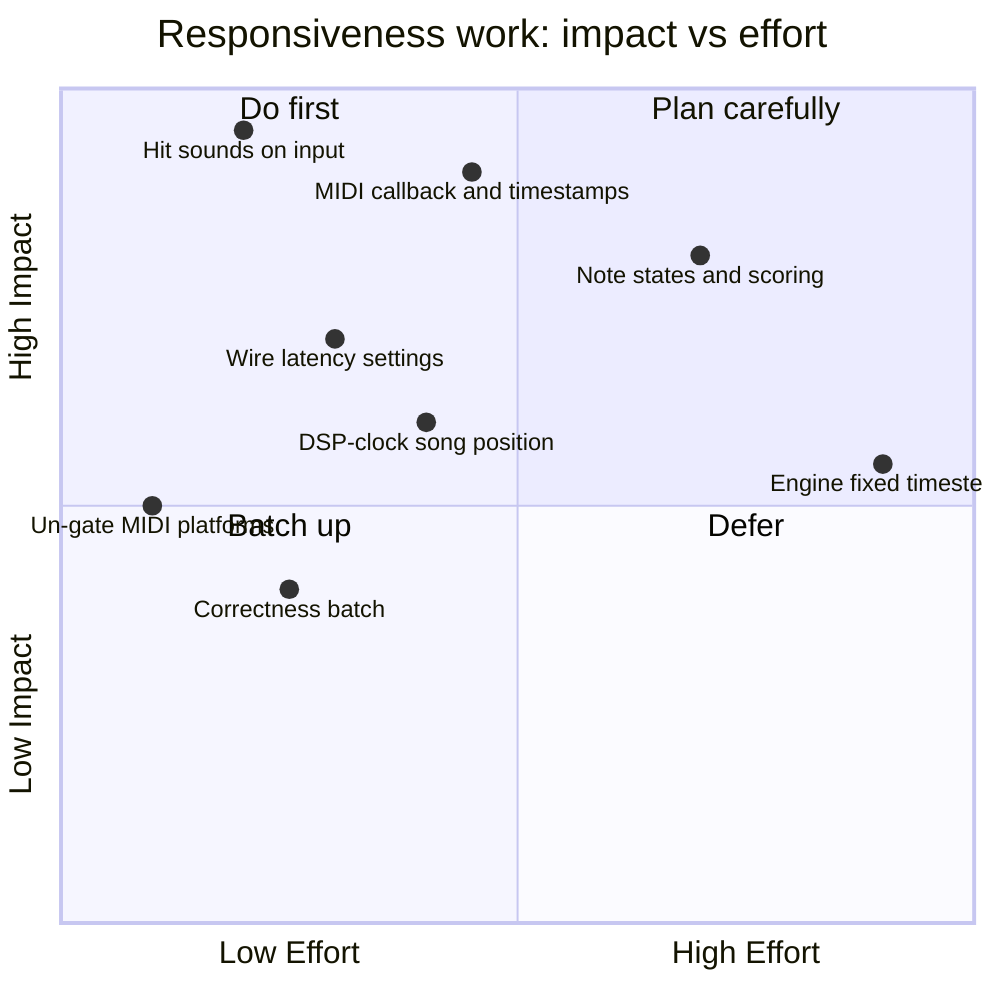

# State of the Game

> **This doc is opinion.** Every other doc in `Docs/` is factual; this one rates, prioritizes, and recommends. Never cite it as a description of behavior — cite the subsystem docs. Assessed at game commit 1714270, 2026-07-10, engine submodule 047f57b8.

Drumsmith is a working vertical slice: real charts parse, stems play in sync, notes scroll, and hits register from a real MIDI kit — on Windows. Its weaknesses cluster in exactly the place a rhythm game can't afford them: the input→judgment→feedback loop is frame-quantized, throws away input timestamps, gives no audio feedback at all, and carries a hardcoded calibration constant while a real calibration system sits half-built around it. The theme of this assessment: **the game's biggest wins are all in the last 50 milliseconds.**

## 1. Maturity Scorecard

Ratings: **Solid** (rely on it) · **Usable** (works, know the sharp edges) · **Fragile** (works until it doesn't) · **Experimental** (incomplete by design) · **Missing** (doesn't exist yet) · **Abandoned-in-place** (do not extend).

| System | Rating | Why (one line) | Doc |
|--------|--------|----------------|-----|
| Note highway (spawn/scroll) | **Usable** | Rewritten 2026-11-08: unsmoothed scroll on an audio-locked clock, per-chart lane layout, lead-in; every note still a live entity | [Gameplay-Note-Highway.md](Gameplay-Note-Highway.md) |
| Hit detection | **Usable** | Per-lane cursors, chords, timestamped MIDI on every platform, graded windows; keyboard still frame-quantized | [Gameplay-Note-Highway.md](Gameplay-Note-Highway.md) |
| Scoring, combo, miss handling | **Usable** | Score, multiplier, combo, accuracy, misses mute the drums, results screen; nothing is saved | [Gameplay-Note-Highway.md](Gameplay-Note-Highway.md) |
| Hit sounds (`Drumset`) | **Experimental** | Right design (`FMOD_CREATESAMPLE` one-shots), zero callers with loaded sounds — silent even in the editor | [Audio.md](Audio.md) |
| Stem playback (`AudioPack`) | **Usable** | Sample-accurate start is genuinely good; pause/seek desync stems, judge clock conflates errors with 0 | [Audio.md](Audio.md) |
| Menu radio (`TrackRadio`) | **Usable** | Works; odd load-loop; only ticks while a menu page is alive | [Audio.md](Audio.md) |
| MIDI input (`MidiDevice`) | **Usable** | Callback with arrival stamps; one queue shared by gameplay and editor widgets; no hot-plug | [MIDI-and-Pads.md](MIDI-and-Pads.md) |
| Pad bindings | **Usable** | Clean data model; rebinding UI is editor-only, so game builds can't remap | [MIDI-and-Pads.md](MIDI-and-Pads.md) |
| Chart parsing / conversion | **Usable** | Pro drums (8 voices), dynamics, tempo map, tolerant MIDI reading; `DISABLE_OPTIMIZATION` remains; RB data can't express hi-hat open/pedal or rims | [Songs-and-DLC.md](Songs-and-DLC.md) |
| Track database / DLC | **Usable** | Scan + download + register work; partial filter coverage, unvalidated downloads | [Songs-and-DLC.md](Songs-and-DLC.md) |
| Track editor | **Usable** | The most complete tool in the project — windowed note iteration gameplay should copy | [Songs-and-DLC.md](Songs-and-DLC.md) |
| Menus / UI | **Usable** | Ported to RmlUi (2026-11-08): sliders read back and apply, DLC catalogue with background downloads, ms latency test; `VideoLatency` still consumed by nothing | [UI-and-Menus.md](UI-and-Menus.md) |
| Settings (`GameSettings`) | **Usable** | Latency fields now consumed; save-on-button only | [Game-Architecture.md](Game-Architecture.md) |
| Latency compensation | **Usable** | Audio and video offsets applied; visual test feeds the video offset; no audio calibration test, positive offsets only | [Latency-and-Responsiveness.md](Latency-and-Responsiveness.md) |
| Vocals mode | **Experimental** | FFT spike printing to stdout; not gameplay | [Gameplay-Note-Highway.md](Gameplay-Note-Highway.md) |
| Venue, band and crowd | **Experimental** | Built 2026-11-08 and only judged from headless software-rendered captures: every chart venue event is used, three rooms with a live swap, but all primitives, no real-GPU or frame-pacing check yet | [Venue-and-Band.md](Venue-and-Band.md) |

## 2. Platform Matrix

| Capability | Win64 | Linux | macOS | UWP |
|------------|-------|-------|-------|-----|
| Build + link (incl. rtmidi/midifile) | ✅ | ✅ | ✅ | ✅ |
| Gameplay keyboard input | ✅ | ✅ | ✅ | ✅ |
| Gameplay MIDI input | ✅ | ✅ | ✅ | ✅ (untested) |
| Editor MIDI (TrackEditor, PadBindingWidget) | ✅ | ✅ (ALSA) | ✅ (CoreMIDI) | n/a |
| DLC download | ✅ (winhttp) | ✅ (curl) | ✅ (curl) | untested |

Gameplay MIDI is no longer platform-gated (2026-11-08); it has been exercised only through autoplay, not with a kit, on Linux.

## 3. Gotchas Catalog

The big list. **Consequence** is what bites you; **Verdict** is what I'd do. Items marked 🎯 directly degrade input feel.

### Input & judgment

| # | Gotcha | Where | Consequence | Verdict |
|---|--------|-------|-------------|---------|
| 1 | 🎯 MIDI queue drained *inside the per-note loop* | `NoteHighwayCore::Update` | Simultaneous kick+snare can never both register; messages checked against one note are discarded for the rest | **Fixed** in the 2026-11-08 gameplay rewrite |
| 2 | 🎯 Queue never drained when no note is in window | same | Stale hits from seconds ago "hit" the next note entering its window; input feel is bimodal | **Fixed** in the 2026-11-08 gameplay rewrite |
| 3 | 🎯 `handled` + `break` = one hit per frame, total | same | Fast fills drop notes even on keyboard | **Fixed** in the 2026-11-08 gameplay rewrite |
| 4 | 🎯 RtMidi timestamps discarded; `MidiMessageNew` has no time field | `MidiDevice::PumpMessages` | Sub-frame accuracy is unrecoverable downstream; all compensation capped at frame granularity | **Fixed** in the 2026-11-08 gameplay rewrite |
| 5 | 🎯 Drain loop exits on any <3-byte message while timing/active-sensing are *enabled* | `MidiDevice` ctor + `PumpMessages` | Drum modules emitting MIDI clock/active-sensing strand note-ons in the queue | **Fixed** in the 2026-11-08 gameplay rewrite |
| 6 | 🎯 Gameplay MIDI is Win64-only by `#if`, not by capability | `NoteHighwayCore::Update` | Linux/macOS players get keyboard only, for no technical reason | **Fixed** in the 2026-11-08 gameplay rewrite |
| 7 | 🎯 Hit window `max(50/noteSpeed, 50)` — scaling then re-clamped | same | `noteSpeed` can only widen the window (<1); the intended difficulty scaling never happens | **Fixed** in the 2026-11-08 gameplay rewrite |
| 8 | 🎯 `globalOffsetMs = -30` hardcoded; `AudioLatency`/`VideoLatency` persisted but never read | same + `GameSettings` | Calibration tuned to one dev machine; user settings are placebo | **Fixed** in the 2026-11-08 gameplay rewrite |
| 9 | 🎯 Judge clock read once per frame from `Channel::getPosition(MS)`; errors return 0 | `AudioPack::GetPositionMs` | Judgment quantized to frame + mixer granularity; a channel hiccup reads as "song at 0:00" | **Partly fixed** 2026-11-08: the clock interpolates between FMOD updates; a channel error still reads as 0 |
| 10 | O(all notes) iteration with two component lookups each, every frame | `NoteHighwayCore::Update` | 4,872 entities scanned per frame for the bundled Everlong chart; author comment says it best | **Fixed** in the 2026-11-08 gameplay rewrite |
| 11 | Velocity parsed from MIDI and dropped — at conversion *and* at input | `ParseMidi`, `PumpMessages` consumers | Dynamics unavailable for hit sounds, scoring, or charts | **Fixed** 2026-11-08: velocity is stored per note (charts and Track Editor recordings); not judged |
| 12 | MIDI device opened by name with assert-then-port-0 fallback; empty device list = UB index | `MidiDevice::OpenMidiDevice` | Wrong device silently opens in release; crash potential with no devices | **Fixed** in the 2026-11-08 gameplay rewrite |
| 13 | Device never closed; `IsOpen` never cleared; no hot-plug rescan | `MidiDevice`, `NoteHighwayCore` | Reconnect/replug requires restart | Same pass as #12 |
| 14 | No in-game pad rebinding (widget is `ME_EDITOR`) | `PadBindingWidget` | Shipped builds depend on a checked-in `PadMappings.json` matching the player's kit | Needs a game-side binding screen eventually |

### Feedback & scoring

| # | Gotcha | Where | Consequence | Verdict |
|---|--------|-------|-------------|---------|
| 15 | 🎯 **No hit sound exists anywhere** — `Drumset` instantiated only in editor, its `loadSound` calls commented out | `TrackEditor::Init`, `Drumset` | The single most important feedback channel in a drum game is absent; even the editor auditions silently | Still open: the drum stems now drop out on a miss, but there is no hit sound |
| 16 | 🎯 Visual hit feedback = entity deletion, deferred one frame by `World::Simulate` | `NoteHighwayCore` + engine | Hit note visibly lingers a frame; no flash/pop/animation to anchor timing perception | **Fixed** in the 2026-11-08 gameplay rewrite |
| 17 | 🎯 No miss detection — expired notes just scroll on | `NoteHighwayCore::Update` | No miss sound/visual, no accuracy data, no fail state | **Fixed** in the 2026-11-08 gameplay rewrite |
| 18 | `m_drumVolume` bumped on hit but `SetDrumVolume` call is commented out | same | The drum-stem ducking mechanic (mute drums until you hit) is half-present and inert | **Fixed** in the 2026-11-08 gameplay rewrite |
| 19 | Judgment `difference` logged via `BRUH_FMT` and thrown away | same | Free per-hit accuracy data (the seed of scoring *and* auto-calibration) evaporates | **Fixed** in the 2026-11-08 gameplay rewrite |

### Audio

| # | Gotcha | Where | Consequence | Verdict |
|---|--------|-------|-------------|---------|
| 20 | Pause/Resume/Seek never re-sync stems (only initial `Play` is DSP-scheduled; `Seek`'s re-sync is commented out) | `AudioPack` | Stems audibly drift after pause or scrub; judge clock moves relative to the mix | **Fixed** 2026-11-08: group pause, and seeks restart every stem on one DSP tick once all have seeked (`Docs/Audio.md`) |
| 21 | `AudioPack` holds a raw `TrackData*` into the database vector | `AudioPack::m_trackData` | `TrackDatabase::Reload` (e.g. after a DLC download) dangles any live pack | Fix when touched; radio + download coexist today |
| 22 | Radio `Update` spams `Play()` every frame while loading | `TrackRadio::Update` | Converges, but masks the readiness model; "this feels weird, but okay??" | Cleanup batch |
| 23 | FMOD runs on default mixer settings, never queried | `AudioCore` (engine) | Nobody knows the actual output latency on any machine | Measure in item 3's calibration work |

### Content pipeline

| # | Gotcha | Where | Consequence | Verdict |
|---|--------|-------|-------------|---------|
| 24 | **`DISABLE_OPTIMIZATION` at file scope, shipped** | `TrackList.cpp`, `CustomTrackDefineTest.cpp` | Database scan, JSON, sorting, and MIDI parsing run unoptimized in release | Delete both lines |
| 25 | `ParseMidi` writes `TriggerTimeMS = seconds × 100` | `CustomTrackDefineTest::ParseMidi` | 10×-wrong ms values live until `Save()` recomputes them; any new pre-save consumer inherits the bug | **Fixed** 2026-11-08 |
| 26 | Hardcoded `bpm = 180/158`, `noteSpeed = 10` at conversion | `ConvertFromLegacy`, `ParseMidi` | BPM is decorative; the moment something trusts it, every chart is wrong | **Partly fixed** 2026-11-08: BPM from the tempo map; `noteSpeed` still hardcoded |
| 27 | Per-note stdout logging in conversion | `ParseMidi` | Converting a library takes minutes and floods the console | **Fixed** 2026-11-08 |
| 28 | Pro-drums remap commented out; 100→`Crash2` catch-all | `GetNoteIdFromLegacy` | Pro charts flatten; cymbal/tom distinction lost | **Fixed** 2026-11-08: tom markers map yellow/blue/green to hi-hat/ride/crash or high/mid/floor tom |
| 29 | `.chart` reader exists but is unreachable; OPUS unsupported | `TrackDatabase::Reload` | Clone Hero-only content silently invisible | Finish or delete |
| 30 | `song.ini` values keep leading spaces; `pro_drums == " True"` | `readSongMetaData` | Shipped `TrackData.txt` files contain padded strings; exact-match filters are one odd tag from missing | Parser pass |
| 31 | Sort comparators capture the track vector **by value** | `TrackDatabase::SortTracks` | Every sort copies all `TrackData` (strings + any note data) into the lambda | One-character fix (`&`) |
| 32 | Filter enum, count logic, and match logic cover different tag sets; unknown tags `YIKES` per track per call | `TrackList.cpp` | GH1–4 filters can't match; log spam scales with library size | Cleanup batch |
| 33 | DLC download: no hash/size check, no partial-failure cleanup | `DLCMenuController::DownloadDLC` | Half-downloaded songs register as playable if `TrackData.txt` landed | Harden when DLC matters |
| 34 | Recording in the editor stamps UI-frame time | `TrackEditor::Render` | The charter's full input latency is baked into `NoteData.txt` for everyone | Inherits item 2's timestamped input |
| 35 | The `TrackDatabase.json` config loads at startup and does nothing | `TrackList` ctor | Dead I/O + confusion | Delete |

### UI & shell

| # | Gotcha | Where | Consequence | Verdict |
|---|--------|-------|-------------|---------|
| 36 | ~~Radio volume slider bound to a misnamed JS global~~ | `MainMenuController` | Fixed by the RmlUi port: the slider is a two-way model value applied live | Done |
| 37 | ~~Latency sliders have no read-back~~ | `MainMenuController` | Fixed by the RmlUi port: sliders show the stored values | Done (consumers still missing, item 3) |
| 38 | The visual latency test measures keyboard-vs-marker offsets in ms and can write the average into `VideoLatency`, but nothing reads that field and MIDI pads don't register | `MainMenuController::UpdateLatencyTest` | Calibrates a value nobody consumes | Wire into judgment in item 3 |
| 39 | The library and the DLC page each build their own `tracks` list and sort/filter code; the DLC page keeps its own copy of the `DLCSource` tag table | `DLCMenuController`, `TrackListMenuController`, `TrackList.cpp` | Three places to update when a tag or sort changes | Share one tag table when touched |
| 40 | The retired Vue project and HTML/CSS/JS pages still ship under `Game/ui/` and `Assets/UI/` | `Game/ui/`, `Assets/UI/*.html` | Dead weight in the assets; misleads readers | Delete |
| 41 | Leaving the DLC page mid-download joins the worker thread, so the scene change waits for the file in flight | `DLCMenuController::~DLCMenuController` | A multi-megabyte stem can stall the transition for seconds | Add a cancel hook to `Web::DownloadFile` |
| 42 | `LaunchPlayTrackEvent` handoff relies on scene-load callback ordering; `TrackID`/`Callback` fields dead | controllers → `NoteHighwayCore` | Works today; silently drops the event if core registration ever lands later | Cleanup batch |
| 43 | `GameSettings` saves only via UI button; `Engine.cfg` has two `Title`s (window shows "MitchEngine") | `GameSettings`, `Assets/Config/Engine.cfg` | Crash loses settings; wrong window title | Trivial fixes |
| 44 | `PlayStem` declared, never defined; `MidiDevice::IsPaused`, `NoteTrigger` float-ms, `FilterTracks` stub | various | Dead surface area that misleads readers | Delete in cleanup batch |

## 4. Half-Finished Inventory

| Item | State | Verdict |
|------|-------|---------|
| Hit sounds (`Drumset` + `Assets/Drums/Basic/`) | Built, never loaded | **Finish** — roadmap item 1 |
| Latency settings + `VisualLatencyTest` | UI + storage only | **Finish** — item 3 |
| Drum-stem ducking (`m_drumVolume`) | Half-commented | Decide in item 6 |
| Pro-drums lane mapping | Commented out | Finish after item 2 |
| `.chart` support | Reader written, unreachable | Finish or delete |
| OPUS support | Blocked on FMOD transcode | Delete the TODO or build the transcode step |
| Vocals mode (`VocalsTestCore`) | FFT spike | Park it — explicitly out of the responsiveness path |
| `LaunchPlayTrackEvent::TrackID`/`Callback` | Dead fields | Delete |
| `AudioPack::LoadURL` streaming | Lightly used | Decide with DLC hardening |
| Legacy HTML pages (`SongList.html`, `TrackStats.html`, `Old/`) and the Vue project | Unused since the RmlUi port | Delete |
| `TrackDatabase.json` config wiring | Vestigial | Delete |
| Venue follow-ups (meant for the MitchEngine Linear board; logged here) | See below | Pick off in order |

**Venue follow-ups**, most valuable first:

1. **Play it on real hardware.** Everything was judged from lavapipe captures. Check frame pacing with the venue on (three camera chains, volumetric haze, ~3,000 entities posed per frame) and whether the haze and beam intensities read the same on a real GPU.
2. **Real models.** Swap the primitive puppets for skinned band and crowd models through the engine's animator (`Engine/Docs/Animation.md`); `Puppet`'s joint positions can drive bones. The crowd would want instanced skinning or vertex-animation textures.
3. **Overlay layers by render group.** Venue and highway are separated by distance (`VenueLayout::kVenueOrigin`); a per-mesh render layer that the overlay and main cameras filter on would remove the trick, and let directional lights stay per layer.
4. **Check the RB2 camera note meanings** (61-64, 70-73) and the spotlight slot order against a known-good chart; the guesses are in `ReadMidiVenue`.
5. **Not yet imported:** PART KEYS_ANIM_LH/RH (keyboard hand notes), vocal phrase markers and lyrics (the singer could mouth them), RB3 `[coop_*]` camera notes in charts that use note-based RB3 cuts, `[mix x drums...]` (drum fills / mixes), and the `[map ...]` hand-map events.
6. **Confetti and smoke.** The engine has particles (`Engine/Docs/Rendering-Pipeline.md`); pyro is a capsule and a point light today.
7. **The `sepia` look renders plain grey.** The tonemapper's white balance runs before saturation, so `Director::GradeFor`'s saturation-0 + temperature looks lose their tint. The fix is a toning LUT like the concert look's (`Assets/Textures/LUTs/ConcertScreen.cube`).
8. **Concert look follow-ups.** The foliage double exposure the real screens had is ME-356. The concert look auto-fills whole quiet sections, so a long bridge (The Kill's is 51 s) stays at 12 fps throughout; cap it if that drags.

## 5. Responsiveness Roadmap

Ranked by perceived-latency impact per unit effort. Engine constraints cited from [Latency-and-Responsiveness.md](Latency-and-Responsiveness.md); mechanics from the factual docs.

1. **Hit sounds triggered on input** — the largest perceived-latency win available, because audio confirmation can beat visual confirmation by multiple frames and drummers calibrate by ear. Instantiate a `Drumset` in `NoteHighwayCore` (or a game-global kit), load `Assets/Drums/Basic/*.wav` (plus the missing pads) with `FMOD_CREATESAMPLE` at track setup, call `hitPad` the moment input matches a pad — *before* judgment, unconditionally (real kits make noise on every hit; the game should too, or duck the sample when the pad is module-monitored). Constraints: `Drumset` uses raw FMOD (no `ResourceCache`), and FMOD's API is thread-safe as initialized — this is also the piece that later moves into the MIDI callback for sub-frame feedback. Wire velocity (`m_data2`) into `velocityToVolume` while there.
2. **RtMidi callback + timestamped queue, drained once per frame** — the structural fix that retires gotchas #1–5 and #34 at once. Register `RtMidiIn::setCallback`; the callback (RtMidi's thread) converts to a message struct **with an arrival timestamp** (steady_clock now, or accumulated RtMidi delta) and pushes into a mutex-guarded (or SPSC ring) queue; optionally fires item 1's hit sound right there (FMOD-safe). `NoteHighwayCore::Update` drains the whole queue **before** the note loop into a per-frame hit list, then matches hits→notes (many-to-many, no `break`). Judgment can then compensate: `effectiveSongTime = positionAtPoll - (pollTime - arrivalTime)`. Hard constraint: the callback must never touch `World`, `EventManager`, or `ResourceCache` (`Engine/CLAUDE.md` hard rule 3) — enqueue only.
3. **Wire `AudioLatency`/`VideoLatency` into judgment and build the calibration loop** — replace `globalOffsetMs = -30` with the settings values (sign conventions documented!), add `Get*Latency_Internal` read-backs so the UI stops zeroing saved values (#37), and turn the calibration idea into ms: audio calibration = tap along to a metronome through the *game's* output using item 1's hit sounds; the existing `BRUH_FMT` difference stream is the measurement. `VisualLatencyTest`'s pixel readout gets rebuilt or retired.
4. **DSP-clock-derived song position** — derive song time from `getDSPClock` deltas (samples ÷ sample rate) anchored at the scheduled start, optionally interpolated with `GameClock` between reads, replacing per-frame `getPosition(MS)` as the judge clock. Kills the quantization and the errors-read-as-zero failure (#9), and pairs naturally with re-syncing stems on pause/seek (#20) since both touch the same scheduling code.
5. **Un-gate MIDI on Linux/macOS** — delete the `#if USING(ME_PLATFORM_WIN64)` around the gameplay MIDI block (trivial after item 2 restructures it). rtmidi already links everywhere; the editor already proves ALSA/CoreMIDI work. Test the empty-device and device-name fallback paths (#12) while there.
6. **Note state machine + scoring** — replace scan-and-delete with per-note state (upcoming → hittable → hit/missed), a sorted cursor into the note list (the `TrackEditor::m_closestNoteIndex` pattern) to kill the O(all-notes) frame cost (#10), immediate visual state change on hit (material/scale swap same-frame instead of deferred deletion, #16), miss handling (#17), and accuracy capture from the `difference` values (#19). This unblocks combo/score UI (RmlUi renders every frame; a `data-model` value is cheap to set per frame), though timing-critical feedback still belongs in-world.
7. **Correctness batch** (small, independent): hit-window scaling intent (#7), `ignoreTypes` or per-message-size handling (#5) wherever polling survives, stems re-sync on pause/seek (#20), close/reopen MIDI device on scene transitions (#13), delete `DISABLE_OPTIMIZATION` (#24), fix the ×100 ms constant (#25), `&`-capture the sort lambdas (#31), fix the radio-volume binding name (#36).
8. **Engine-side, deferred to the engine roadmap** (`Engine/Docs/State-of-the-Engine.md`): fixed timestep (engine priority #4, explicitly motivated by this game), vsync/frame-pacing options (would lower the polling floor below display refresh). Don't block game-side items on these — items 1–6 are all achievable within current engine constraints.

## 6. Top Priorities

1. **Hit sounds (item 1).** *Why now:* biggest feel improvement per line of code in the repo; everything else calibrates against it. *First step:* uncomment and finish the `loadSound` calls in `TrackEditor::Init`, hear it work in the editor, then move the kit into gameplay.
2. **MIDI callback + timestamps (item 2).** *Why now:* it's the structural fix behind five separate catalog entries, and every week of chart-authoring and calibration done before it bakes polled-latency assumptions into data. *First step:* add the timestamped message struct + queue to `MidiDevice` behind the existing `PumpMessages` signature, switch `NoteHighwayCore` to a pre-loop drain, then flip to `setCallback`.
3. **Real calibration (item 3).** *Why now:* the `-30` constant is silently wrong for every machine that isn't the dev box, and the settings UI actively destroys saved values. *First step:* read the two settings in `NoteHighwayCore::Update` and add the two JS getters.
4. **Kill the stale-queue/multi-hit bugs before recording more charts (falls out of item 2).**
5. **The correctness batch (item 7)** — an afternoon of one-line fixes with outsized cleanliness payoff (`DISABLE_OPTIMIZATION` alone is a free performance win).

## 7. Reassessment Triggers

Re-rate this doc when any of: item 1 or 2 lands (the scorecard's two worst rows flip); the engine ships fixed timestep or vsync options (re-derive the latency budget); scoring exists (new "game loop" sections become factual docs); or a real latency measurement (loopback test) contradicts the derived budget in [Latency-and-Responsiveness.md](Latency-and-Responsiveness.md).
